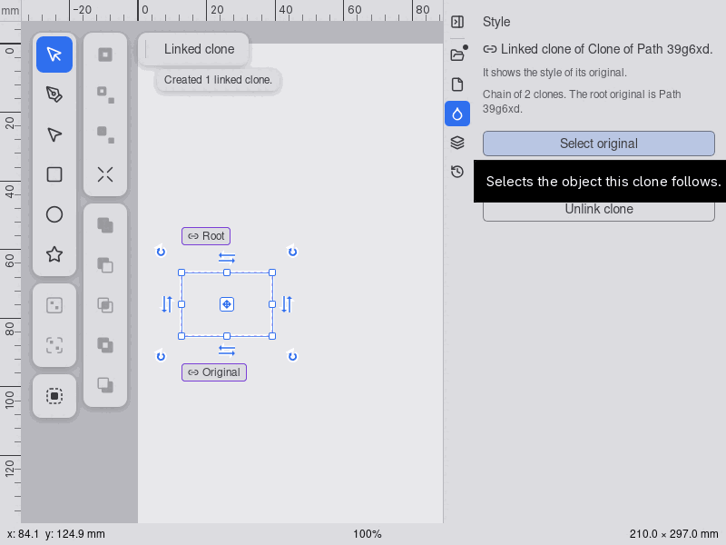
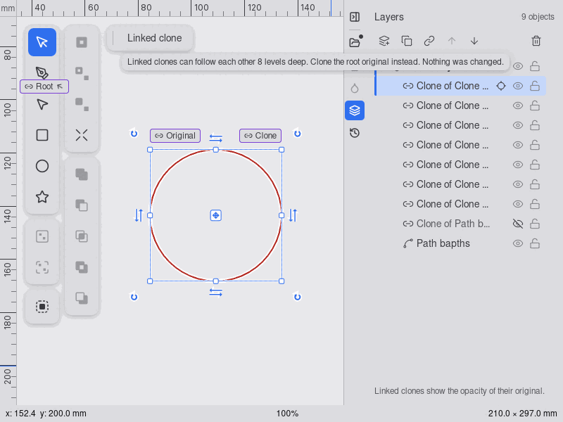
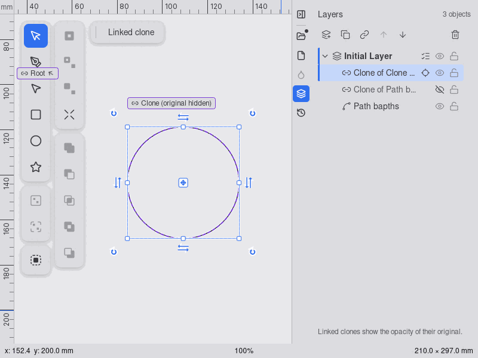
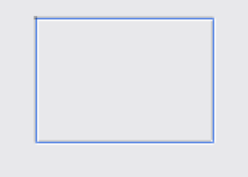
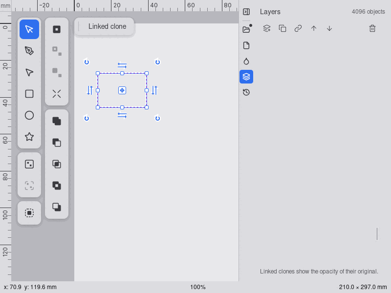
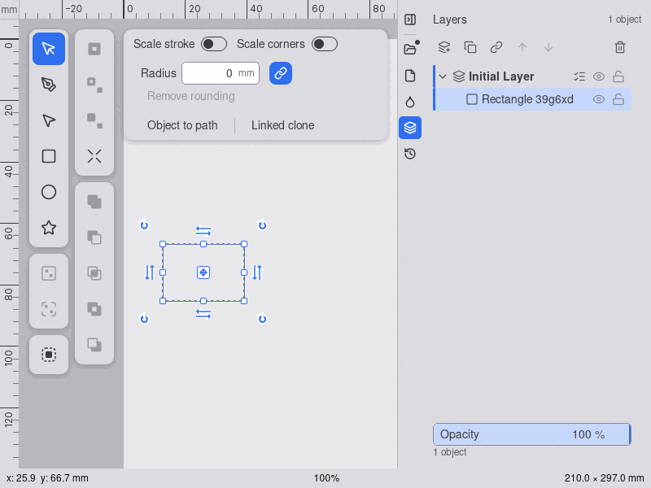
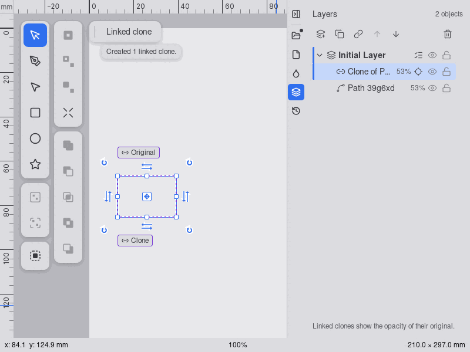

# UX review of 0049 linked clone

Branch `story/linked-clone`, head `dcef9db`. Reviewer: ux-engineer, 2026-10-14.
Checked against `specification.md` (criteria and UX notes), the clone parts of
`specs/0050-layers-and-objects-panel/specification.md` (criteria 7, 24 to 26, 28, 36, 38, 45, 55 to 57)
and `docs/design-system.md` ("Linked clone in the UI", "Properties panel: linked clone", "Linked clone
marks", "Properties panel: Layers tab").

**Verdict: CHANGES REQUESTED.** Linked clone itself works from both places, and the canvas marks,
the Layers rows, the refusal at depth 8 and the busy state are good. But the clone block of the Style
tab cannot be reached: the Style tab is dimmed whenever only clones are selected. So Unlink clone and
Select root original have no trigger anywhere in the build, and Select original is only on the Layers
row. In addition, every notice the clone commands post to the panel is lost, the hover box sticks
after a press, and a selected clone that lies on its original loses its own mark. Ten must-fix items
in total; most are small.

## How this was tested

WebKitGTK 2.54 `MiniBrowser` under Xvfb, viewport exactly 800 x 600 CSS px, real pointer and key input
from `xdotool`, the `npm run build` of `dcef9db`, served by a review-only page server that injected a
small script to read the DOM (in a scratch folder inside the project directory, deleted afterwards).
One browser at a time.

To review the clone block at all, I built a **review-only copy** in which the Style tab is enabled
for any non-empty selection (one line in `panel_tabs.rs`, reverted at once; the worktree is clean and
the shipped `dist` was not touched). Screenshot `01` and the block rows of the table below come from
that copy; everything else comes from the real build.

**Not verified:** Chromium, WebView2, WKWebView; a canvas zoom (the build has no zoom key reachable
from xdotool and Ctrl+wheel zooms the WebKit page), so the 6 px ring was only seen on a scaled clone;
the faint view's "Original (12 clones)" tag (dropped every time, finding 12).

## Results per check

| Check | Result |
|---|---|
| Linked clone in the Select bar | PASS. Last, after Object to path, no glyph, 28 px, three-line tooltip below. Rectangle and ellipse are converted silently ("Path bapths"). New clone selected, notice "Created 1 linked clone." 4 px under the button, `role="status"`, gone after 3 s. With only clones selected the two switches and Object to path leave the bar (criteria 18, 27) |
| Linked clone in the Layers toolbar | Works (criterion 3 chain made from it). **No notice appears** (finding 2). **Glyph `Link` is the Link corners glyph** that the Select bar shows at the same time (finding 11, screenshot `06`) |
| Busy state | PASS. 2,048 paths: wait cursor and `aria-busy` on `html` for 0.7 s, then 2,048 clones selected, no tags, panel count exact |
| Marks: trace, casing, dash, order | PASS on a separated clone (dashed 6 / 3 over white casing, under the box and handles). **Fails on a clone that lies on its original**, which is the state right after every Linked clone (finding 4, screenshot `01`) |
| Tags avoid handles | PASS for short words: "Clone", "Original", "Root" move to the raised or lowered candidate and never meet a glyph. Long words are always dropped at ordinary sizes (finding 12) |
| "Clone (original hidden)" | PASS once the clone is large enough (186 x 186 px, screenshot `03`); dropped at 80 x 60 px (finding 12) |
| Reference marks of `0047` | Move chip opened with M on the root: no overlap seen. Not tested over the 200 generated selections of the spec (that is the unit test) |
| Edge chips | Shown and pointing the right way, **but drawn over the tool rail** (finding 6, screenshots `02`, `03`) and not moved on pan (finding 7) |
| Ring under 6 px | A clone scaled to 4 px: no ring visible, the handle stack covers it. Acceptable for a single selected clone; not checked at small zoom |
| Clone block in the Style tab | **Unreachable** (finding 1). In the review copy: texts, order, sizes (row 1 14 px, row 2 12 px muted, buttons 256 x 28 px at full body width, chain line and Select root original only from depth 2, block 124 px, chain 200 px) PASS. Tooltips are native `title` (finding 13). Subject line in the header is empty (finding 1) |
| Origin line | PASS: "1 linked clone follows this object." and **Select clone** above Stroke |
| Select original / root / clones | Row action Select original PASS (selects A for B, one step). Style tab buttons only in the review copy: they select correctly; **hover box sticks after the press** (finding 3, screenshot `04`); the hover box **hides the traces** instead of sitting above them (finding 3) |
| Hidden or locked targets | Row action: the right sentence, but `role="status"`, not `alert` (finding 17). Select clone in the Style tab with a hidden clone: **no notice at all** (finding 2) |
| Unlink | Review copy only: the clone becomes a path and stays selected. **No "Unlinked 1 clone." notice** (finding 2); keyboard focus goes to the canvas, not to Stroke Paint (finding 5) |
| Delete of an original | Notice reads "1 clone became a path." **without "Deleted 1 object."** (finding 10) |
| Layers rows | PASS: `Link2` glyph, "Clone of Path 39g6xd" cut by the ellipsis, tooltip with the whole name and "Linked clone, chain of 2. Root: Path bapths", own eye and lock, `Locate` row action, root's opacity as readout ("53%" on the clone row while the root is 53 %, screenshot `07`), Opacity field caption "Linked clones show the opacity of their original." Accessible name ", clone" instead of ", linked clone" (finding 14) |
| Layers list with many objects | **Blank** at 4,096 objects after Ctrl+A (finding 9, screenshot `05`) |
| Screen reader | "Linked clone of Path bapths selected, 21.2 by 15.9 mm. Its original is Path bapths." PASS. For a chain the "Root original: ..." sentence is missing (finding 15) |
| Keyboard path | Tab order bar button, strip, Select original, (Select root original), Unlink clone: PASS. Enter presses. No key starts a clone command: PASS. Focus after a key press: fails (finding 5) |
| Refusal at depth 8 | PASS for the rule, the red refusal outline and the text; the alert is one 551 px line that runs over the panel (finding 8, screenshot `02`) |
| Refusal at 10 km | Typed move of the root by 9,999,960 mm: refused, nothing moved, alert in the canvas slot: "Nothing was changed: Clone of Path bapths would move beyond the limit of 10 km." Copy order (finding 17) |
| Node tool | PASS: the bar pill "Linked clones have no nodes. Edit the original or unlink the clone." (wraps to two lines at 800 px), no overlay, marks shown |

## Customer rule of 2026-10-12

"The right panel never grows sections for an operation; operations are tools or actions with a
visible trigger; nothing appears out of nowhere."

**The clone block follows the rule.** It is not a section that an operation opens: it is what the
Style tab shows for a selection that has no style of its own, in place of the style sections and
never in addition to them. It is there in the same frame as the selection, with nothing to open,
expand or confirm. Its three buttons are the visible triggers of Select original, Select root
original and Unlink clone. Linked clone opens nothing in the panel. The origin line follows from
the selection in the same way (an object that clones follow).

Two remarks that keep it so: (a) the notices of the block must be transient and anchored as the UX
notes say (finding 2), and must not become a status row inside the block; (b) the origin line sits
above Stroke, so the Stroke controls of a path that has clones sit 52 px lower than those of a path
without clones. That is still selection state, not an operation, and I accept it; if the customer
dislikes the jump, the line can move under the Style sections without any other change.

## Must fix (before the PR)

1. **The Style tab is dimmed when only clones are selected, so the clone block is unreachable.**
   `panel_scope_non_empty` uses the style scope, which leaves clones out (criterion 24). Unlink clone
   and Select root original then have no trigger in the build; Shift+Ctrl+F also stays on Document.
   Fix in `curvyo-editor-wasm/src/session/panel_tabs.rs`: the Style tab counts as non-empty when
   the selection holds a clone (the style edits keep using the style scope). The header's subject
   slot is empty for a clone in the review copy; it must read "Clone of Path 3f9a1c" (criterion 21,
   `PropertiesPanel.tsx` / the subject read).
2. **Notices with `source: "panel"` are drawn only by the History tab.** Lost: "Unlinked 1 clone.",
   the hidden-or-locked refusals and the "Selected 2 of 3 originals." line of Select original, Select
   root original and Select clones, and the Layers toolbar's "Created 1 linked clone.". Fix in
   `frontend/src/hooks/useClones.ts` (`run`): block notices 4 px under the pressed button (Unlink:
   where the button was, as a child of the panel body, UX notes "Focus"); the Layers toolbar's
   Linked clone posts to the canvas notice slot, as Duplicate does.
3. **The hover box sticks.** After Select original or Select root original the button unmounts
   without `pointerleave` or `blur`, so `set_clone_hover` is never cleared: the blue box stays on
   the former target with nothing selected (screenshot `04`). Fix in `CloneBlock.tsx`: clear the
   hover in an effect cleanup and before the press. While the hover box shows, the violet traces
   disappear; the design system draws the hover box above the traces without hiding them
   (`clone_marks` suppression or the frame's `suppressed` flag).
4. **A selected clone lying on its original loses its mark.** Right after Linked clone on a clone,
   the canvas shows "Root" and "Original" and no "Clone" (screenshot `01`): tags are placed in
   stacking order, so the selected clone, placed last, gets no free candidate. Its dashed trace
   lies over the original's solid trace on the same outline and reads as solid. Fix in
   `curvyo-ui-core/src/clone_marks.rs`: place tags in role order (Clone, Original, Root), and do not
   draw an Original or Root trace whose outline equals a selected clone's outline (its tag stays).
5. **Focus after a key press goes to the canvas.** UX notes: after Unlink clone to Stroke Paint;
   after Select original or Select root original to the first control of the new body (Select
   clones for a path, Select original for a clone). Fix in `CloneBlock.tsx` (`detail === 0` branch).
6. **Edge chips are drawn over the tool rail** (the "Root" chip covers the Pen and Node buttons,
   screenshots `02`, `03`). `CloneTags.tsx` places a chip at `max(4, x - 40)`. Fix: clamp chips
   right of `--rail-right` + 12 and below the bar, using the chip's real width.
7. **Tags and chips do not follow a pan.** They are read in `syncFromSession` only; after a wheel
   scroll they stay at the old screen place until the next document change. Fix: call
   `clones.refresh` on every view change (`useEditorSession.ts`).
8. **The depth-8 alert runs over the panel.** One 551 px line from the Select bar into the Layers
   toolbar. Fix in `SelectToolbar.tsx`: `max-w-[320px]`, wrapping, right-aligned to the button as
   the UX notes say, clamped inside the canvas.
9. **The Layers list is blank with many objects** (4,096 after Ctrl+A, screenshot `05`). The window
   starts at `min(range.first, focusedRaw)` and is capped at 60 rows, so with the focus on row 1 it
   renders rows 1 to 60 while the list is scrolled to 114,000 px. A `0050` bug that Linked clone of
   many objects exposes. Fix in `LayersTab.tsx` (lines 160 to 162): render the scroll window, plus
   the focused row on its own when it lies outside.
10. **Delete of an original loses its first sentence**: "1 clone became a path." instead of
    "Deleted 1 object. 1 clone became a path." (criterion 31). `handleCloneOutcome` in
    `useEditorSession.ts` posts the repair sentence over the Delete notice; join the two.

## Should fix

11. Layers toolbar: the Linked clone button uses `Link`, the Select bar's Link corners glyph, which
    is on screen at the same time (screenshot `06`); the UX notes call that pair a trap. Use
    `Link2`, the clone glyph of the rows, tags and block (`LayersTab.tsx`). The design-system
    Toolbar row gets this glyph in a follow-up docs change (not in this commit).
12. Tag candidates: the raised and lowered candidates at 30 px meet the corner rotate glyphs, which
    reach about 30 px out, so any tag wider than the space between them is dropped ("Clone (original
    hidden)" and "Original (1 clone)" at 80 x 60 px). My numbers were wrong: make it 36 px
    (`TAG_RAISED_GAP_PX` in `clone_marks.rs`); "Tag placement" in the design system is corrected
    in the same follow-up.
13. The block's tooltips are native `title` (black, under the pointer, covering the next button,
    screenshot `01`). Use the panel `Tooltip`, `side="left"`, 400 ms (`CloneBlock.tsx`).
14. Row accessible name: ", clone" must be ", linked clone" (`layerRows` label in the session).
15. Selection announcer for a chain: add "Root original: Path 3f9a1c." (design system, Screen reader).
16. Tag radius 4 px; the design system says 8 px (`CloneTags.tsx`).
17. Copy and roles: "Clone of Path bapths would move beyond the limit of 10 km. Nothing was changed."
    (reason first, as every other refusal); the row action's hidden-or-locked refusal is `role="alert"`.
18. Spec conflict: criterion 22 shows the clone block only for clones only; the UX notes and the
    design system say a mix of an original and its clone shows both. The build follows criterion
    22. Default: keep it; the design-system row "Origin line" is corrected in the same follow-up.

## Screenshots (`ux-screens/`)

`01` (review copy): chain block; native tooltip covers Select root original; no "Clone" tag; the
hover box hides the traces.

`02`: refusal outline and alert; the alert runs into the panel; edge chip over the rail.

`03`: "Clone (original hidden)" and the "Root" chip over the rail.

`04`: nothing selected, pointer elsewhere; the hover box stays.

`05`: 4,096 objects, empty list.

`06`: Link corners and the Layers toolbar's Linked clone, same glyph.

`07`: notice under the button, tags, clone row with the root's 53 %.

## Re-check of must-fix 1, 2, 3, 7 (head 7ec8b8e, 2026-10-14): CHANGES REQUESTED

PASS: **1** (Style tab active for clones, block and subject "Clone of Path ..."; the fresh clone keeps its "Clone" tag), **3** (no stuck hover box after mouse or key press; traces over the hover box; key focus goes to Select clone), **7** (tags follow a wheel pan). Traces stay under every handle glyph of the Select tool: PASS.
Still must-fix:
- **2:** the block notices are now shown, but in the flow at the top of the body: "Unlinked 1 clone." and the hidden-clone alert push Stroke (or Select clone) 44 px down and back after 3 or 8 s, against the customer rule (`08`). Make them overlays 4 px under the button (`CloneBlock.tsx`).
- **New, from the right-aligned bar notice:** the depth-8 alert starts at x = -54, under the rail and off screen (`10`). Clamp right of `--rail-right` + 12 (`SelectToolbar.tsx`).
- **New, from the draw order:** the red refusal outline at depth 8 is now under the violet traces and cannot be seen (`10`). Draw the refusal outline after `clone_mark_layer` (`draw.rs`).
- **New:** after a pan, the "Clone" tag is drawn over the Select bar (`09`). Treat the bar and the rail as the viewport edge in tag placement (`useClones.ts` obstacles / `clone_marks.rs`).
Design-system rows updated in a separate commit (draw order, tag gap 36 px, toolbar glyph, notice overlays).
