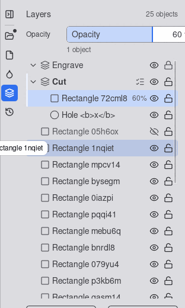
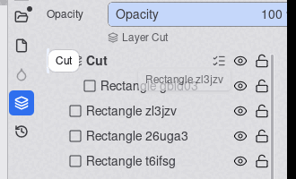
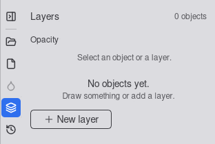
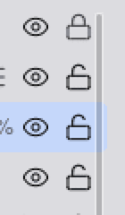

# UX review of 0050 layers and objects panel (with 0051 amendments)

Branch `story/layers-and-objects-panel`, head `0e93a1c`. Reviewer: ux-engineer, 2026-10-12.
Checked against `specification.md` (criteria and UX notes), `specs/0051-sidebar-and-no-menu/` and
`docs/design-system.md` ("Properties panel: tabs", "Properties panel: Layers tab", "Color tokens").

**Verdict: APPROVE WITH CHANGES.** The structure, the keyboard model, the drag rules, rename, the
canvas hover and the footer work. Seven must-fix items are left. Most are small CSS and focus fixes,
but three of them break things the maker sees all the time: on the Linux build the selection and
active-layer marks are invisible, the Opacity field is cut off, and the lock button mostly cannot be
clicked. All seven should be fixed before the PR opens. A short re-check of the screenshots is enough
after that; this review does not have to run again in full.

## How this was tested

The brief asked for Playwright Chromium at `/opt/pw-browsers`. That directory does not exist on
navi, there is no other Chromium on the machine, and `playwright install` was not allowed. I used the
WebKitGTK 2.54 `MiniBrowser` instead. This is the engine of the Linux desktop build, which makes the
check of criterion 32 more useful than Chromium would have been. It ran headless under Xvfb, with a
viewport of exactly 800 x 600 CSS px. Real pointer and key input came from `xdotool`. A
review-only page server (outside the repo, deleted afterwards) served the `vite build` of `0e93a1c`
and injected a small script that reads the DOM, computed styles and contrast. **Not verified:**
Chromium, WebView2 (Windows) and WKWebView (macOS). One of these should be checked on a VM that has
`/opt/pw-browsers`.

## Results per check

| Check | Result |
|---|---|
| Tab: fourth of five (File, Document, Style, Layers, History), 28 x 28 hit area, 16 px glyph, name and tooltip | PASS (measured: Layers at y 143, 28 x 28, glyph 16 x 16) |
| AC 3: widths at 800 x 600 | Strip 32 + body 280; canvas region 488 (464 viewport + 24 ruler): PASS. **Content width 256 px, not 244**: finding 5 |
| AC 3: 12 rows at 800 x 600 | List 408 px = **14.6 rows**: PASS. Header 52 px, footer fixed |
| AC 6: row visuals | Order of the parts, 28 px rows, readout "60%", own hidden or locked as a shape, inherited state as `EyeOff` in a dotted ring, hidden name muted: PASS. Colours: findings 1 and 4. Indent: (level - 1) x 16, so top-level rows have no indent and the glyph starts at 24 px. I accept this: it gives top-level names 16 px more, and I will update the "Row" line of the design system to match |
| AC 8: 6 px mark on a collapsed container | Drawn, but **invisible** (fill `oklch(0.97 0 0)`): finding 1 |
| AC 15 and the brief: hover highlight on the canvas | PASS for the pointer and for keyboard focus; it goes away when the pointer leaves or Escape returns to the canvas (pixel diff) |
| Rename | Double-click and F2 open the field with the text selected; Enter commits; surrounding spaces are trimmed; `<b>x</b>` stays plain text; the first Escape cancels and stays in the list, the second goes to the canvas: PASS. Low: finding 17 |
| Opacity header | **Fails**: finding 3 |
| Footer: New layer, Delete layer | New layer creates "Layer N" in front of the active layer, with the name in edit; Delete layer's slot is reserved: PASS. Empty state: finding 9 |
| AC 29: pointer drag into a layer, out of a layer, between rows | Moves are correct, with the 4 px threshold, the 70 % ghost, the `grabbing` cursor, refusal by `not-allowed` with "Layers stay at the top level", and Escape cancelling without writing: PASS. **The insertion line is invisible (finding 1), the "into" outline is never drawn (finding 2), and the edge scroll stops when the pointer stops (finding 8)** |
| AC 32: Alt+arrows in WebKitGTK | Alt+Up, Alt+Down, Alt+Left and Alt+Right reach the page. `preventDefault` stops Back: the URL hash and the history stay the same and no `popstate` fires. Each move is announced ("Moved Rectangle 72cml8 to position 1 of 2"). **Focus does not stay on the moved row** (finding 6). **Alt+Home in MiniBrowser took the browser to its home page**: the browser's own shortcut won over the page, and the unsaved document was lost (finding 13) |
| AC 38 to 40: roving focus and key map | One Tab stop. The Tab order is collapse control, tablist, Opacity, list, New layer, Delete layer: PASS. Up, Down, Home and End work; Right expands, or moves from name to eye to lock; Left goes back through the cells, then collapses, then goes to the parent row: PASS. Shift+Ctrl+L focuses the first selected row: PASS, except when that row is inside a collapsed container (finding 11). Escape returns focus to the canvas and keeps the selection; Ctrl+Z works inside the list: PASS |
| AC 41: contrast and focus ring (light) | Name on panel 8.3:1, on the selected ground 7.8:1, on the hover ground 6.6:1. Muted text 5.0:1 on panel, 4.7:1 on selected, **4.0:1 on hover** (finding 10). Focus ring (2 px `--editor-accent`, inset) 3.3:1 on panel, 3.1:1 on selected, **2.65:1 on hover**. **Selection and active-layer bar 1.25:1** (finding 1). **Calm eye or lock 14.5:1, louder than the own state at 8.3:1** (finding 4) |
| AC 41: dark theme | Does not apply: only the light theme exists (`docs/design-system.md`, line 11) |
| Customer rule of 2026-10-12: no sections grow for an operation, nothing appears out of nowhere | **Met.** Nothing in the tab grows. Delete layer appears in a slot that is already reserved, as the direct result of clicking a layer row. The Opacity slot (52 px) and the hint line are reserved. Row actions are drawn over the end of the name, so nothing reflows. Notices go to the canvas notice slot. One exception, finding 9: in the empty state the footer jumps |

Screenshots: 

`01`: the Opacity field is cut off at the right ("60 %"). The bars on Cut and on the selected row
are near-white lines. The hover ground on "Rectangle 1nqiet" is stronger than the selected ground.

## Must fix (before the PR)

1. **`--accent` is shadcn's near-white, not the design system's blue.** Several marks use it: the
   3 px bar on a selected row and on the active layer, the insertion line, the entered-group
   outline, the "contains the selection" diamond and the drag count badge (white text on a
   near-white ground). All of them measure about 1.25:1 against the panel, so they cannot be seen.
   `index.css` (lines 103 to 108) explains why the editor's blue is called `--editor-accent`.
   Fix: in `frontend/src/components/panel/LayerRow.tsx` and `LayersTab.tsx` (the badge), replace
   every `var(--accent)` with `var(--editor-accent)`.
2. **The "into" outline is never drawn.** The row's base class contains `outline-none`, which
   beats `outline outline-[1.5px]`: the computed outline style is `none`. Fix in `LayerRow.tsx`:
   draw the target with `ring-[1.5px] ring-inset ring-[var(--editor-accent)]`, or with an
   absolutely positioned 1.5 px border span, as the entered-group outline is drawn.
3. **The Opacity header overflows by 56 px.** A 60 px label "Opacity" is placed before
   `ValueField`, which is a fixed 244 px wide and draws its own "Opacity" label. The field runs to
   x = 844 (the panel ends at 788), the value and "%" are cut off, and the word appears twice.
   Fix in `LayersTab.tsx`: drop the outer label, show `ValueField` at full width with its own label
   (the same field as in the Style tab), and put the caption under it starting at x = 0. Keep the
   52 px slot. The tooltip "Fades fill and stroke separately..." goes on the field. I will change
   the "Header" line of the design system to say this.
4. **Two tokens are used but never defined: `--lane-line` and `--field-border`.** Because
   `--lane-line` is missing, the calm `Eye` and `LockOpen` inherit near-black (14.5:1). They are
   louder than the own hidden and locked states (8.3:1), so only the shape tells them apart, and
   the panel looks busy. Fix: add `--lane-line: #7B7B7F` to `frontend/src/index.css` (design
   system, colour table). Give the footer buttons the border of "Fit to content"
   (`color-mix(in srgb, var(--toolbar-icon) 60%, transparent)`, `DocumentSection.tsx`); the rename
   field uses that border too.
5. **The list is 256 px wide, and on WebKitGTK the scrollbar covers the lock button.**
   `scrollbar-gutter: stable` reserves nothing for GTK overlay scrollbars (`clientWidth` = 256).
   The scrollbar's hit area covers x 768 to 788, so a click on the right two thirds of every lock
   reaches the scroller instead (`elementFromPoint` returns the treegrid; clicks at x 768 and
   further right did nothing, a click at x 763 worked). The Opacity field and the footer also end
   12 px to the right of the controls in every other tab. Fix in `LayersTab.tsx`: give the tab
   column a 12 px right inset (`pr-3` on the header, list content and footer), so rows are 244 px,
   as the design system says. Keep `scrollbar-gutter` for Chromium.
6. **After Alt+arrow, focus stays at the old position instead of following the moved row**
   (criterion 32 says "keeps the focus on the moved row"). Alt+Down on row 1 left focus on the
   row that moved up into place 1; Alt+Right into a layer that already had a child left focus on
   that child. Fix in `LayersTab.tsx` `onListKeyDown`: after `reorder_layer_rows`, find the moved
   row's id in the new view and call `setFocused` with its index (or have the session return the
   index).
7. **Delete on a focused row deletes the selection, even when the focused row is not selected**
   (tester finding 4). Reproduced: with "Rectangle 72cml8" selected, Down Down to
   "Rectangle 05h6ox", then Delete removed 72cml8. That row may be scrolled out of view. Ctrl+Z
   restores it, but the key has destroyed something the maker was not looking at. UX decision: the
   key acts on what the focus shows. If the focused row is selected, Delete deletes the selection,
   as now. If it is not, Delete deletes only the focused row and the selection stays. Same for
   Backspace. `LayersTab.tsx` and the session's `delete_layer_row`. The wording of criterion 37
   needs a one-line change by the product owner. My default if nobody objects: as described here.

## Should fix (this PR if cheap, otherwise an issue)

8. **The edge scroll only runs while the pointer moves.** With the pointer held in the bottom
   edge zone, `scrollTop` stayed at 28 for 1 s and moved only on the next mousemove. Fix: while
   the pointer is in the zone, scroll on an interval of one row per frame or per 50 ms, with no
   easing (`LayersTab.tsx`, `edgeScroll`).
9. **In the empty state the footer jumps 370 px.** The list is `hidden`, so New layer sits at
   y 160; after the first object it moves to the bottom. Fix: keep the flex-1 list area in the
   empty state and put "No objects yet." inside it, so the footer stays at the bottom.
10. **The row hover is stronger than the selected row.** The hover ground is
    `--editor-accent-hover` (20 %); the selected ground is `--value-fill`. Muted text on the hover
    ground measures 4.0:1. Fix: use `--row-hover` (8 %, 4.58:1), as the History list does. I will
    update the "Row states" line of the design system to match.
11. **Shift+Ctrl+L can leave focus with no visible ring.** When the first selected row is inside
    a collapsed container, focus lands on the treegrid itself, which has `outline-none`. Fix:
    focus the nearest visible ancestor row, the one that shows the diamond.
12. **Name tooltips open during a drag.** "Cut" appeared over the strip while a row was dragged
    over it. Fix: suppress the row tooltips while `drag.active` is true.
13. **Alt+Home and Alt+End in the browser build.** In MiniBrowser, Alt+Home navigated away at
    once, because the browser shortcut was handled before the page. In the Tauri window there is
    no browser shortcut, so the desktop build is probably fine. Do the spec's fallback (Shift+Alt+Home
    and Shift+Alt+End) for the browser build now, unless a Chromium check shows that
    `preventDefault` stops it there. Alt+Up and Alt+Down are safe. Alt+Left and Alt+Right were
    stopped in WebKitGTK.
14. **Tester finding 1: a non-contiguous selection moves as a block, and nothing happens at an
    edge.** UX decision: step each node on its own, as Illustrator's Bring Forward does. Each
    selected node passes its next unselected sibling, and a node already at the edge stays put.
    "Nothing happens without a word" is the worst outcome: if a key changes nothing, announce
    "Already at the front" or "Already at the back". This changes no acceptance criterion
    (criterion 32 does not say how a split selection moves); `curvyo-ui-core` `reorder_plans`.

## Low

15. The eye and lock change their label ("Hide" or "Show") **and** set `aria-pressed`, so a
    screen reader hears the state twice and contradicts itself ("Show, pressed"). Keep the
    changing label and drop `aria-pressed` (`LayerRow.tsx` `FlagButton`).
16. The row-action gridcell sits inside the name gridcell. Make it a sibling cell of the row
    (`LayerRow.tsx`).
17. The rename field has `maxLength={256}`, but the spec allows 128 characters, so text past 128
    is cut without notice. Use 128. Replace `bg-white text-black` with the field tokens of the
    panel.
18. The caption reads "Layer Layer 1" for a layer with the default name. Acceptable; it reads
    better once the layer is renamed, which New layer prompts for.

## Tester findings: UX opinion

- **(1) A non-contiguous selection moves as a block:** step each node on its own, and announce a
  move that changes nothing (item 14). This is not a blocker.
- **(4) Delete on a focused row:** this is a must-fix (item 7). Delete acts on the focused row
  unless that row is part of the selection.

## Design-system changes I will make after the fixes land

- The "Header" line: the field is used as in the Style tab, with no outer label (item 3).
- The "Row" line: the indent is (level - 1) x 16.
- The "Row states" line: hover uses `--row-hover` (item 10).
- A note that `--accent` must never be used in editor code.
