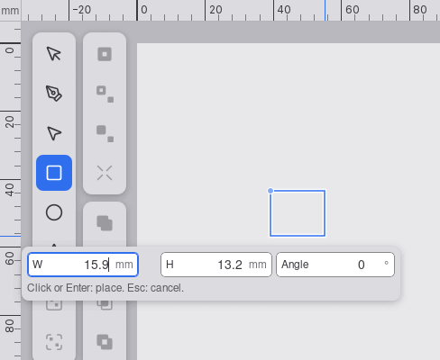
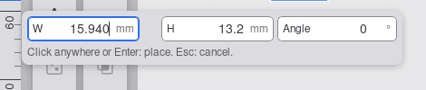
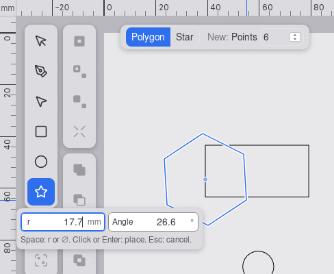
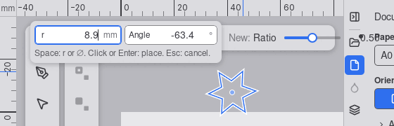
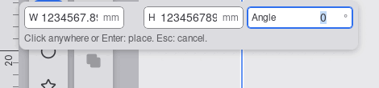
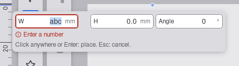
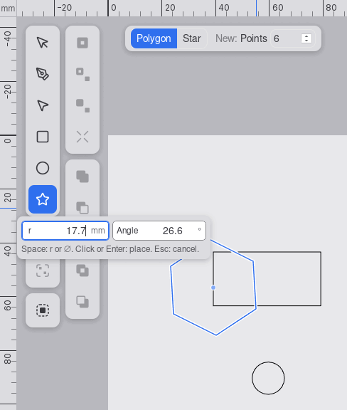

# UX review of 0052 click to create shapes

Branch `story/click-to-create-shapes`, head `fa122ab`. Reviewer: ux-engineer, 2026-10-14.
Checked against `specification.md` (criteria and UX notes) and `docs/design-system.md` (rows
"Placement chip", "Transform pivot marker", rail tooltip).

**Verdict: CHANGES REQUESTED.** The flow is right: click, follow, type, Tab, Enter or a second
click, Escape twice. The hint texts, the live region, the tooltips, Space and the r/⌀ button, the
refusal message and the keyboard-only start all work as specified. Five must-fix items are left. The
first two break the main mouse flow: digits typed after moving the pointer are appended to the live
value, and the chip can catch the pointer so that the shape stops following it.

## How this was tested

WebKitGTK 2.54 `MiniBrowser` under Xvfb with a viewport of exactly 800 x 600 CSS px, as in the
`0050` review. Real pointer, wheel and key input came from `xdotool`. A review-only page server
(inside the project directory, deleted afterwards) served the `npm run build` of `fa122ab` and
injected a probe that logged the chip's rectangle, field values, selection ranges, focus and live
region after each event. **Not verified:** touch and pen (two-tap creation, criterion 31; xdotool has
no touch), app zoom by Ctrl+wheel (MiniBrowser zooms the page itself before the app sees the event;
the app's zoom runs through the same `onWheel` handler as the wheel pan, so finding 3 applies to it),
Chromium, WebView2 and WKWebView.

## Results per check

| Check | Result |
|---|---|
| Criterion 11: chip opens in the click's frame, focus in the first field, text selected | PASS when you type at once (selection 0 to 3 on "0.0"). **Fails after the pointer has moved**: finding 1 |
| Criterion 11: chip 12 px from the pointer, away from A | PASS in the open canvas (measured gap 12 px on both axes). Before the freeze, the chip can catch the pointer: finding 2 |
| Criteria 11, 33: clamping at the four edges and corners (A within 40 px of the edge) | Six positions measured with the rectangle chip (420 x 60 px). The chip stays inside the canvas, never covers A or the pointer, and the hint never wraps: PASS. It covers the tool rail and the active tool's bar: finding 4 |
| Criterion 33: 9 digits plus suffix | **Fails**: "123456789" and "1234567.89" overflow W and H (scroll width 125 and 129 px, client width 122 px): finding 5 |
| Criterion 13: Tab cycle | W, H, Angle, W; Shift+Tab back; each field selected on Tab; no freeze; focus never leaves the chip: PASS |
| Criterion 20: Space | Ellipse and polygon: r to ⌀ and back, label, `aria-pressed` and accessible name ("Diameter", "Outer radius") switch; no space typed; no pan. Rectangle: Space does nothing, and holding Space while moving does not pan: PASS. Clicking the r/⌀ button switches the mode and leaves focus in the field: PASS |
| Criteria 21, 22: Enter and a second click | Enter places "40", Tab, "20" as 40 x 20 mm; a frozen click elsewhere places the typed circle; the Select tool becomes active, focus is on the canvas, the live region says "Rectangle placed, 40 by 20 millimetres." / "Circle placed, radius 6 millimetres.": PASS |
| Criterion 7: Escape | First Escape cancels (live region "Cancelled.", focus on the canvas, tool kept), the second switches to Select: PASS. A press in the sidebar cancels: PASS |
| Criterion 23: refusal | "abc", Enter: red border, `aria-invalid`, "Enter a number" with the alert glyph under the fields, text selected, message announced, cleared on the next key: PASS (screenshot 06) |
| Criterion 25: the Polygon/Star bar | A click on "Star" keeps the placement and the typed "25", the group becomes "New star": PASS. Focus stays on the bar button, so Enter now presses "Star" again instead of placing: low, finding 7 |
| Criterion 26: Enter on the canvas | Placement at the pointer, "30", Tab, "20", Enter places 30 x 20 mm: PASS |
| Criterion 29: hints and tooltips | Rectangle: "Click or Enter: place. Esc: cancel."; ellipse and polygon: "Space: r or ⌀. Click or Enter: place. Esc: cancel."; after the first edit: "Click anywhere or Enter: place. Esc: cancel."; rail tooltips: "Rectangle tool (R) / Shift: from center. Ctrl: square or circle / Click, then type a size", "Polygon/star tool (*) / Click, then type a size": PASS |
| Criterion 9: middle-button pan | A stays fixed in the document and the preview follows the pointer: PASS. The chip stays where it was until the next pointer move: finding 3 |
| Criterion 9: wheel pan with the pointer still | **Fails**: A moves with the document, but the preview and the field values keep the old shape until the pointer moves (screenshot 07): finding 3 |
| Double-click suppression (tester finding 1) | A second click 4 px from A within 400 ms is swallowed: no shape, the placement goes on. After 400 ms, a click 4 px from A places a 1.1 x 0 mm rectangle (criterion 4 as written). See finding 6 |
| Contrast | Hint 5.0:1 on `--toolbar-bg`, placeholder "4.6 × 4.0" 6.9:1, suffix 4.6:1, error text 4.8:1, field border 3.5:1: PASS. The pivot marker (`--accent` at 60 %) is 2.1:1 on the canvas: finding 8 |
| Hit targets | Fields 28 px high, r/⌀ button 24 x 28 px, as the design system says: PASS |

Screenshots (800 x 600, cropped):

## The customer rule (no growing panel, a visible trigger, nothing out of nowhere)

**Met, with finding 4.** Nothing in the right panel changes while a placement runs. After placing,
the sidebar shows the Style tab for the new selection; a create-drag does the same on `main`, so this
is not new. The chip is the direct result of the click: it appears in the same frame, on the canvas,
12 px from the pointer and away from A, so the eye is already there. The rail tooltip says "Click,
then type a size" before the first try. In the open part of a large window the chip appears where
the user expects it. At 800 x 600 it does not always: the canvas is 464 px wide, the rectangle chip
is 420 px, and the "other side of A" fallback pushes the chip to the far left, over the tool rail,
and near the top over the tool's own bar (screenshots 01, 03, 04). The fix is in finding 4.

## Must fix (before the PR)

1. **Typed digits are appended to the live value after the pointer moves.** Each pointer move writes
   a new value into the focused field (a controlled input), and the browser then puts the caret at
   the end. Typing "40" after moving gives "15.940" in W (screenshot 02). This affects almost every
   mouse placement. Fix in `frontend/src/components/PlacementChip.tsx`: while `!chip.frozen`, in a
   `useLayoutEffect` on the field texts, call `select()` on the focused input, so the live value
   stays selected and the first key replaces it.
2. **Before the freeze, the chip can catch the pointer.** The chip is drawn one or more events
   behind the pointer. When the pointer moves towards the chip's side by more than 12 px per event,
   it lands on the chip. The canvas then gets no pointer moves, the shape stops following, and the
   maker has to move off the chip. Reproduced in 1 of 3 runs of the same 4-step move. Fix in
   `PlacementChip.tsx`: `pointer-events: none` on the chip while `!chip.frozen`. The UX notes already
   say the chip cannot be reached before the freeze, so a press that lands on it then counts as a
   canvas click (it places, which is what the maker meant).
3. **A wheel pan (and a zoom) with the pointer still does not update the preview or the chip.**
   Criterion 9: the preview follows the pointer's document position. After a wheel step, A moves
   with the document, but the shape and the field values stay as they were until the next pointer
   move (screenshot 07). After a middle-button pan, the preview is right but the chip stays where it
   was. Fix in `frontend/src/hooks/useEditorSession.ts`, `onWheel` and at the end of a pan: forward
   the pointer's unchanged screen point to the session as a pointer move (the session then recomputes
   the live shape), then call `refreshPlacementRef.current()`.
4. **The chip covers the active tool's bar and the tool rail.** With the pointer above A near the
   top, the chip lies over the Polygon/Star bar (screenshot 04), which criterion 25 needs during a
   placement. Ellipse and polygon chips (272 px) are pushed over the rail although there is room to
   their right (screenshot 03). Fix in `frontend/src/lib/readoutPlacement.ts`,
   `placePlacementChip`: (a) take the bar's rectangle as `avoid`, as `placeReadout` does for the
   Select bar; (b) take `railClear`, as `placeOffsetEntryChip` does, and apply it when the chip fits
   right of the rail; (c) on an axis without room, use the "other side of A" only when the other axis
   does not already keep the chip clear of A; otherwise clamp on that axis, so the chip stays next to
   the pointer. At 800 x 600 the 420 px rectangle chip cannot clear the rail, and that overlap is
   accepted. I will update the design-system row "Placement chip" to match.
5. **Nine digits do not fit (criterion 33).** W, H and r are 124 px with 20 px left and 32 px right
   padding, which leaves 70 px for text; "123456789" at 14 px tabular figures needs about 76 px.
   Fix in `PlacementChip.tsx`: `LENGTH_FIELD_PX = 132` (as Angle). The rectangle chip becomes about
   436 px and still fits the 464 px canvas. I will change the widths in the design-system row.

## Should fix or note (not blocking)

6. **Double-click suppression of 3 to 5 px.** I accept the frontend's behaviour: a quick double-click
   with a small tremor must not make a sliver, which is what criterion 5 wants. The product owner
   should reword criterion 5: "a press within 3 px of A, or within 5 px of A and 400 ms of the first
   click, is ignored". A slow second click 3 to 5 px from A still places a 1.1 x 0 mm rectangle
   (tester finding 2); this follows criteria 4 and 23 and stays.
7. **A click into a field after the freeze puts the caret where you clicked**; it does not select
   the text (WebKit's mouseup clears the selection made on focus). Criterion 13 asks for the text to
   be selected on focus. Fix: select on the first mouseup after a focus. Also, after a click in the
   Polygon/Star bar, focus stays on the bar button, so Enter presses it again. Return focus to the
   first chip field after a bar change.
8. **The pivot marker at A is 2.1:1 on the canvas.** This is a design-system token, not an
   implementation fault. A matters more here than in a Shift-drag (the typed angle turns about it).
   I will look at the marker token separately; no action for the implementer.
9. **Not this story:** at 800 px the Star bar ("New: Ratio" slider and "0.50") runs past the canvas
   into the sidebar strip (screenshot 04, top right).

## Re-check: Shift and Ctrl tap toggles (criterion 37, tip 32bdc93)

`MiniBrowser` 800 x 600 under Xvfb, real keys from `xdotool`, build of the tip. **APPROVE**, no must-fix.
- A Shift tap or Ctrl tap changes the preview and W/H at once, with the pointer still (rectangle: from centre, then square; polygon: Ctrl snaps the angle). Shift+A does not toggle: the preview stays as it was.
- The checks use the Move chip's pattern (14 px box, 12 px label), read "From centre (Shift)", "Square or circle (Ctrl)" and, for polygon and star, "Snap angle (Ctrl)". A click on a check flips the same state as the key; the check follows a key tap.
- Typing a value still works (W "20" gives 20 x 20 with Ctrl on); the checks disappear at the first edit, as criterion 37 says. The square state stays visible as the link icon between W and H; "from centre" has no marker after the freeze (note, not a fault).
- The two-row chip fits at 800 x 600 (screenshots tg-01, tg-02); the known rail overlap of the rectangle chip (finding 4) is unchanged.
- Not verified: a tap with Ctrl really held together with a toggle (xdotool cannot hold a key across a pointer event here).
