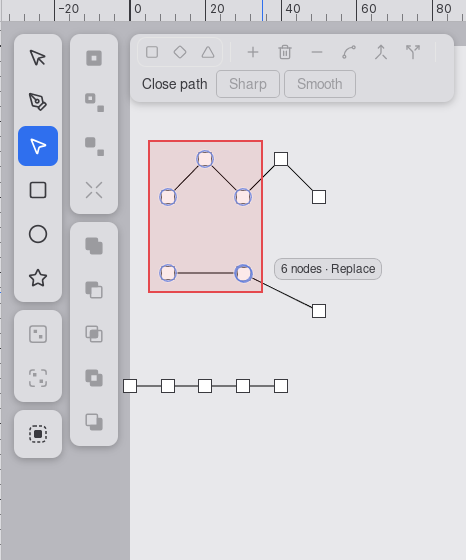
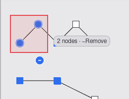
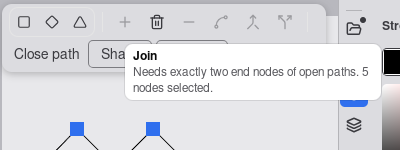
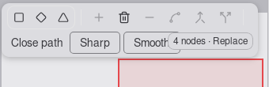
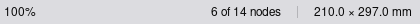

# UX review of 0053 node marquee selection

Branch `story/node-marquee-selection`, head `fa82bf0`. Reviewer: ux-engineer, 2026-10-14.
Checked against `specification.md` (criteria and UX notes) and `docs/design-system.md` (rows
"Node marquee", "Status bar", "Marquee/lasso modifier-state legend", "Modifier badge", "Select all").

**Verdict: CHANGES REQUESTED.** The marquee itself is right: box, rings, legend text, Shift and Ctrl,
the minus badge, Escape, Ctrl+A, the cursor, the cross-path Delete and node-kind actions, Join and
the status-bar count all behave as the notes say. Three must-fix items are left. All three are small:
the legend lies on top of the Node bar, the screen reader stays silent on a repeated Ctrl+A or
marquee, and the focus ring on the disabled Join cannot be seen. A re-check of these three is
enough; the review does not have to run again in full.

## How this was tested

Same setup as `specs/0050-layers-and-objects-panel/review-ux.md`: the WebKitGTK 2.x `MiniBrowser`
(the engine of the Linux desktop build), under Xvfb, viewport exactly 800 x 600 CSS px, real pointer
and key input from `xdotool`. A review-only page server in the project directory (deleted afterwards)
served the `npm run build` output of `fa82bf0` and injected a small script that reads the DOM and
computed styles. Test document: four open paths drawn with the Pen (a 5-node zigzag, two 2-node
paths with coincident ends at (30, 60), a 5-node straight line at y = 90), 14 nodes. Not verified:
Chromium, WebView2, WKWebView; the 60 fps real-window check of criterion 25 (the tester's release
benchmarks pass).

## Results per check

| Check | Result |
|---|---|
| Box (AC 2) | Red contain box with the 12 % fill, any direction, drawn every frame: PASS |
| Rings (AC 10) | 18 px rings in the 65 % tone with white casing on every node in the box, across paths, none outside it, no plain hover during the drag. Readable under the red fill: PASS. Low: finding 7 |
| Legend text (AC 10) | "6 nodes · Replace", "3 nodes · +Add", "2 nodes · −Remove" (U+2212), live with the modifiers: PASS. Placement: **fails next to the Node bar** (finding 1). Low: finding 6 |
| Shift adds, Ctrl removes (AC 5 to 8) | 6 then Shift-box +3 = "9 of 14 nodes"; Ctrl-box over 2 selected = "7 of 14": PASS |
| Minus badge | Ctrl held over nothing shows it; over a node it does not; during a Ctrl marquee it stays: PASS |
| Escape (AC 11) | Box, rings, legend and crosshair go in the same frame, selection unchanged ("7 of 14"), the release after it does nothing: PASS |
| Cursor | Arrow before the press, `crosshair` from the press on nothing to the release, arrow after Escape: PASS |
| Ctrl+A (AC 22) | "13 of 13 nodes", announced: PASS. Announcement on repeat: **fails** (finding 2) |
| Status-bar count (AC 23) | "14 nodes", "6 of 14 nodes", "1 of 13 nodes"; 16 px, 1 px divider, 16 px, then the size; zoom stays centred at x = 400; gone outside the Node tool: PASS |
| Delete across paths (AC 18) | 9 nodes on 3 paths: the 3 paths are removed, one step, toast "Undid: Delete nodes (3 paths)." on Ctrl+Z: PASS |
| Make corner, symmetric, asymmetric across paths (AC 20) | Make symmetric on 7 nodes of 4 paths: all converted, one step "Change node type (4 paths)", undo restores the selection: PASS |
| Join reason (AC 19) | 5 nodes: "Needs exactly two end nodes of open paths. 5 nodes selected."; an end node and an interior node: "... 1 of 2 selected nodes is not an end node."; a valid pair: no reason line, Join enabled, joins at (30, 60). Shows on hover and on keyboard focus; `aria-disabled`, focusable, Enter and Space do nothing: PASS. Focus ring: **fails** (finding 3). Muted line `#5A5A5F` on white, 6.9:1: PASS. Low: findings 4 and 5 |
| Announcement (AC 24) | "6 nodes selected." after a marquee, "13 nodes selected." after Ctrl+A, in the polite selection announcer, nothing on a node click: PASS for the first time. **Silent the second time** (finding 2) |
| AC 26 at 800 x 600 | Status bar: the right column is 368 px; "123456 of 999999 nodes" (133 px) plus divider and "210.0 × 297.0 mm" needs 264 px: never clipped, PASS. Legend: stays inside the canvas and flips left at the right edge, but **covers the Node bar** (finding 1), so this part fails |
| Press near a segment (AC 18 example) | See "Criterion 18 example" below |
| Customer rule: no panel sections for an operation, visible triggers, nothing out of nowhere | **Met.** No panel grows. The count lives in the existing status bar and only with the Node tool active; the reason is a tooltip line on the button it explains; the legend, rings and badge belong to the drag and vanish with it. The panel switching from Document to Style when nodes are selected is older behaviour (a node click does the same), not this slice |

Screenshots:

## Criterion 18 example: change the spec, not the tolerance

The segment hit tolerance is 4 px (`SEGMENT_TOLERANCE_PX`, `tolerances.rs`; design-system row
"Segment hover highlight"), not about 5 px as the tester estimated. At 100 % zoom 1 mm is 3.78 px, so
a press at (5, -1) lies just inside it and hits the segment. In the real window it depends on how the
pointer rounds: my press landed at y = 88.87 (4.3 px off the line) and started a marquee. An example
that works or not depending on a fraction of a pixel is a bad example.

Keep the tolerance. 4 px is shared with the segment hover band and the segment bend of `0031`, and
the band shows the maker in advance that a press there would take the segment, so the rule is
visible. Making it smaller to fit an example would make segments harder to grab everywhere.
**Product owner:** change the example in criterion 18 to a marquee from (5, -3) to (35, 3)
(11 px from the line). The result is the same, a two-node path from (0, 0) to (40, 0). The tester's
(5, -2) (7.6 px) is also fine.

## Must fix (before the PR)

1. **The legend covers the Node bar.** At 800 x 600 the Node bar wraps to two rows (Close path on
   the second). With the pointer just under the bar or over it, the legend "4 nodes · Replace" is
   drawn on top of the Smooth button (screenshot 04). Cause: `measureBar` in `Canvas.tsx` looks for
   `[data-context-bar]`, and only `SelectToolbar.tsx` sets it, so the legend's flip rule never sees
   the Node bar. Fix: add `data-context-bar=""` to the root `div` of `NodeToolbar` in
   `frontend/src/components/NodeToolbar.tsx`, on both the bar and the compound-path pill.
2. **A repeated marquee or Ctrl+A is not announced.** Ctrl+A says "13 nodes selected."; Escape clears
   the selection but the live region keeps "13 nodes selected."; the next Ctrl+A sets the same text,
   the DOM does not change, and nothing is spoken (observed with a MutationObserver). The same
   happens for two quick marquees with the same count (the press clears the text, but the 500 ms
   settle in `SelectionAnnouncer` hides the empty state). This fails criterion 24 for the second
   time, and while the text is stale it contradicts the status bar. Fix: in
   `curvyo-editor-wasm/src/session/node_marquee.rs`, clear `node_announcement` on every node
   selection change that does not announce (Escape, click, Delete, tool change). In
   `frontend/src/components/SelectionAnnouncer.tsx`, make an identical sentence speak again: have
   Rust send a sequence number with the text and key the update on it, or set the region to "" for
   one frame before the new text.
3. **The focus ring of the disabled Join is invisible.** `opacity-40` is on the button, so the
   focus ring fades with it: measured `#C4C4C6` on the bar's `#DCDCE0`, 1.27:1 (WCAG 1.4.11 asks for
   3:1). Join is the only disabled control that can take focus, so this is the one place where a
   keyboard user lands on a faded button and cannot see where they are. Fix in `JoinButton`
   (`NodeToolbar.tsx`): put `opacity-40` on a `span` around the icon, not on the button, and draw
   the focus ring in `--editor-accent` (`focus-visible:ring-[var(--editor-accent)]`, 3.3:1 on the
   bar).

## Should fix (small, in this PR if convenient)

4. **The Join reason wraps mid-sentence.** "... open paths. 5 / nodes selected." (screenshot 03): the
   content is capped at 256 px. Fix in `JoinButton`: put the count sentence on its own muted line
   (rule line, then "5 nodes selected." or "1 of 2 selected nodes is not an end node."). The
   tooltip then has four short lines, which is still within the bar tooltip form.
5. **Two tooltip styles in one bar.** Join uses the house `Tooltip` (white popover, 400 ms); every
   other Node bar button still uses the native `title` (black, OS delay). Next to each other this
   looks like a bug. Fix: give the other buttons in `NodeToolbar.tsx` the same `Tooltip` with
   `side="bottom"` and drop `title`. Accepted as a follow-up if it does not fit.
6. **The legend has no tabular figures and is not `aria-hidden`.** Both are in the UX notes. The
   chip is the shared `ReadoutChip` in `frontend/src/components/Canvas.tsx`; add `tabular-nums` and
   `aria-hidden` there. This also helps the Select legend and the drag readouts.

## Low

7. During the drag, a selected node inside the box shows as a blue disc: the 65 % ring and its
   casing cover the corners of the filled 14 px glyph, so the node kind (square, diamond, triangle)
   is not readable until the release. Acceptable for a transient state; no change asked.
8. After a click on a Node bar button, Delete and Backspace do nothing until the canvas is clicked,
   because the focus stays on the button (gate of `0010` criterion 55). Older behaviour, but the
   marquee makes "select, convert, delete" a common sequence. Candidate for a later fix: return
   focus to the canvas after a pointer click on a bar button.
9. The ring of the enabled Node bar buttons (`focus-visible:ring-ring`, about 1.9:1 on the bar) is
   also below 3:1. Older behaviour; worth one `chore/` for all bars together.

## Design system

No change needed. The rows "Node marquee", "Status bar" and "Select all" match the build. If the
product owner takes finding 4, I will add the four-line form to the tooltip row.
