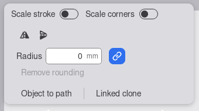
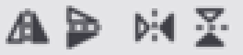
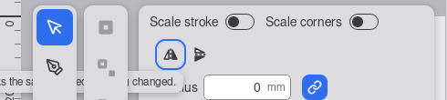
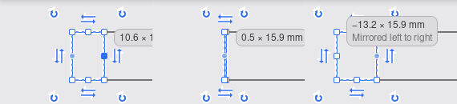
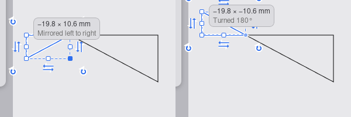
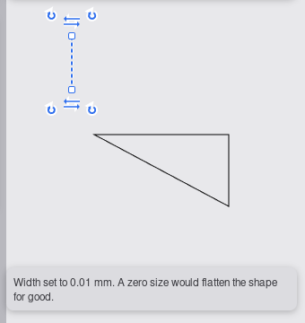
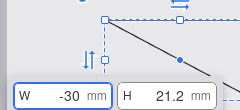
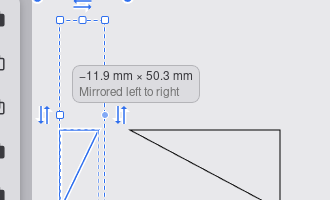

# UX review of 0056 mirror and negative scale

Branch `story/mirror-and-negative-scale`, head `bb125e0`. Reviewer: ux-engineer, 2026-10-15.
Checked against `specification.md` (criteria 1 to 17 and the UX notes) and `docs/design-system.md`
(rows "Flip buttons", "Signed size readout", "Entry chip: negative and zero", "Select bar layout",
"Transform handle layout", "Hidden, not disabled").

**Verdict: CHANGES REQUESTED.** The core of the slice works and feels right: the flip is one click
or one key, one history step with its name, undo is exact, the drag through zero follows the pointer
with no wall, the readout gets its minus and the "Mirrored left to right" line, a typed 0 becomes
0.01 mm with its notice, and the chip shows the mirror note while a field is negative. Five must-fix
items are left. All are small and local to the frontend or the handle drawing. A re-check of these
five is enough.

## How this was tested

As in the reviews of `0050` and `0053`: WebKitGTK `MiniBrowser` under Xvfb, viewport exactly
800 x 600 CSS px, real pointer and key input from `xdotool`, the `npm run build` output of
`bb125e0` served by a review-only page server (in the project directory, deleted afterwards) that
injected a small script reading the DOM, the live regions and the cursor. Test document: a
rectangle, a three-node closed path, and both selected together. **Not verified:** dark theme (no
theme switch is wired in the app yet), 2x pixel density, Chromium, WebView2, WKWebView, a rotated
single object dragged through zero (the tester's ac12 covers the numbers), and the frame rate with
5,000 objects in the browser (the tester's release benchmarks cover the native budgets).

## Results per check

| Check | Result |
|---|---|
| Flip group: place, size (AC 1) | Two 28 x 28 px buttons, 4 px apart, `role="group"` "Flip", after the switches and before the kind groups: PASS. At 800 x 600 it wraps whole to row 2, as the UX notes predicted; it never moves between nothing selected and a selection (x 173, y 76 in both): PASS. Row counts: finding 6 |
| Names, tooltips (AC 1) | Names "Flip horizontally" / "Flip vertically", no `aria-pressed`; tooltip "Flip horizontally (H)" + rule line, and while nothing is selected the third line "Select an object first.": PASS |
| Disabled state (AC 1) | `aria-disabled="true"`, no `disabled` attribute, glyph at 40 %, no hover fill, keeps its Tab stop and tooltip, click and Enter do nothing: PASS |
| Glyphs | Told apart at a glance, but they do not read as flips: **fails** (finding 4) |
| Tab order, focus | Switch, switch, Flip horizontally, Flip vertically, Corner radius, Link corners, Remove rounding, Object to path. Focus ring 2 px accent with offset, visible. Enter flips and focus stays on the button; a mouse click returns focus to the canvas: PASS |
| Flip (AC 2) | Mirrors about the box centre, box unchanged, one step "Flip horizontally" / "Flip vertically", selection kept: PASS |
| Announcement of a flip (AC 2) | First flip announced. **A second flip in the same direction is silent** (finding 1) |
| No-op flip (AC 3) | A plain rectangle flipped: nothing written, notice text right. **The notice is cut off at the left window edge and drawn under the tool rail** (finding 2). From H or V it shows in the canvas notice slot: PASS |
| H and V (AC 4) | Flip in the Select tool, nothing in the Node tool, "Select an object first" with nothing selected; Shift+Ctrl+H still opens History: PASS |
| Chip open + flip (AC 5) | Size chip with W typed 50 and not committed, click on Flip: chip closes, only the flip is written: PASS |
| Edge drag through zero (AC 6, 7, 10, 11) | No wall, no snap; preview, readout and handles of the result by position; after the release the handle at the left is W: PASS. **The grabbed handle loses its dragging look after the crossing and is not drawn while the box is under 24 px** (finding 5) |
| Ctrl corner drag, non-dominant axis (AC 8) | The object jumps across the fixed line by its own height when the pointer crosses it by 2 px; the readout changes to "−19.8 × −10.6 mm / Turned 180°" in the same frame. It reads as cause and effect, not as a glitch. Keep criterion 8 as written; no fallback needed |
| Escape | Drops a drag that has crossed zero, nothing written: PASS |
| Zero recovery (AC 15) | Typed 0 in W: 0.01 mm, one step "Resize", notice "Width set to 0.01 mm. A zero size would flatten the shape for good." in the canvas notice slot (two lines at this width, readable), polite status: PASS. The 0.01 mm box is drawn as a dashed line with its handles. Pull-apart works; low finding 8 |
| Signed readout (AC 10) | "−13.2 × 15.9 mm" + muted "Mirrored left to right" for one object; "−11.9 mm × 50.3 mm" for a multi-selection; "0.5 × 15.9 mm" near zero: PASS. Format question: see below |
| Release announcement (UX note) | **Missing**, after a drag released beyond zero and after Enter with a negative size (finding 3) |
| Typed negative (AC 14, UX note) | "-30" accepted; while it is in the field the note "Mirrored left to right" shows under the fields; fields carry `title` and description "Millimetres. A minus sign mirrors."; Enter mirrors about the centre (key S): PASS |
| Undo (AC 29) | Ctrl+Z three times after H, V, H: each "Undid: Flip … (1 path).", the path is back exactly; redo branch kept in History: PASS |
| Customer rule: no panel sections for an operation, visible triggers, nothing out of nowhere | **Met.** The flip is two visible buttons in the Select bar (with H and V written in their tooltips); no panel grows. The readout line exists only during the drag that causes it, the chip note only while the maker types a minus, the zero notice only after the Enter or release that caused it |

## The readout format: the code is right, the spec example is not

The tester found "−12.0 × 10.0 mm" for one object where criterion 10 shows "−12.5 mm × 8.0 mm".
The app has two readout formats from before this slice: one object "W × H mm" (`0005`), a group
"W mm × H mm" (`0019`). The design-system row "Signed size readout" names both and the code
follows it (screens 04 and 08). Criterion 10's example is the group format. **Change the spec, not
the code:** criterion 10 should read "−12.5 × 8.0 mm" (one object; "−12.5 mm × 8.0 mm" for a
multi-selection). Merging the two formats into one is worth a separate `chore/` later; it is not part
of this slice.

## Findings

Must fix:

1. **A repeated flip is not announced.** `FlipGroup.tsx` renders `{flip.announcement.text}` in the
   live region; `useFlip` counts an `id` so a repeated sentence is spoken again, but the id is never
   used. H then H, or V then V: the text does not change, so the DOM does not change and a screen
   reader hears nothing. The same applies to a button press after a key. Fix: key the text node on
   the id (`{flip.announcement.text}` inside the region); it is
   the same problem as finding 2 of the `0053` review (a repeated Ctrl+A). Related: the region sits inside the Select bar, which
   unmounts in other tools; on the way back to the Select tool it is re-created holding the last
   announcement. Clear the text when the bar unmounts, or move the region next to the other polite
   regions of the editor.
2. **The no-op notice is cut off and covered.** It is right-aligned to its button
   (`absolute top-full right-0`, `FlipGroup.tsx`). At 800 x 600 the button is at x 173 of the
   viewport, so the 320 px notice starts at about x −100: its start is off-screen and the tool rail
   is drawn over the rest (screen 03). Fix: left-align it to the button (`left-0`, not `right-0`)
   and keep it inside the canvas like the readout (`placeReadout` clamping), with a z-index above
   the tool rail. The UX note said "right-aligned"; that was wrong for a group that sits at the
   left end of the bar. Left-aligned is the rule from now on.
3. **No announcement after a resize that mirrors.** UX note "Announcement": a release beyond zero
   announces "Resized. Mirrored left to right." (or "… Mirrored top to bottom." / "… Turned 180°.").
   Nothing is said today, neither after a release nor after Enter in the size chip with a negative
   value (also found by the tester). Fix: when the committed resize has a negative factor, set a
   polite announcement "Resized. " + `mirror_line(sx, sy)` + "." in the session (next to
   `take_transform_notice`, `curvyo-editor-wasm/src/session/`) and speak it from the pointer-up and
   the entry commit in `useEditorSession.ts`, using the counter rule of finding 1. A resize with
   positive factors stays silent, as today.
4. **The glyphs read as a warning sign and a play button.** The two right-angled triangles with
   the right angle at the axis join into one triangle with a dashed line through it: the
   horizontal flip looks like "⚠", the vertical one like "▶" (screen 02, left pair). That is the
   drawing the UX note asked for, so the note was wrong; the review test it set ("told apart at a
   glance") passes, but a glyph that reads as "warning" in a toolbar fails the purpose. Fix in
   `FlipGlyph` (`FlipGroup.tsx`): the triangles point at the axis, the flat side outside. Outlined
   `M1.75 3.5 L5.75 8 L1.75 12.5 Z`, filled `M14.25 3.5 L10.25 8 L14.25 12.5 Z`, same dashed axis,
   same rotation for the vertical flip (screen 02, right pair). Update the glyph text of the row
   "Flip buttons" in `docs/design-system.md` to match.
5. **The grabbed handle is lost during a drag through zero.** In `select_view.rs` (the single-object
   decoration, about lines 237 to 290, and the group variant) the dragging look goes to the handle
   whose name equals the grabbed one. After the crossing the grabbed E handle sits where the W
   handle is drawn, so the solid handle under the pointer becomes a plain white one; and while the
   box is under 24 px the edge handles are filtered by the size tiers, so the handle under the
   pointer is not drawn at all (screen 04, middle and right). Fix: during a resize drag, map the
   grabbed handle through the current signs (mirrored once per negative axis;
   `opposite_direction` in `transform_math.rs` is the both-axes case) to the handle at the pointer, draw that one in the dragging look, and never filter it by the tiers. The other
   handles may keep following the tiers per frame: I withdraw the "frozen handle set" rule of the UX
   note in favour of this narrower rule; the implementer updates the "Through zero" sentence of
   "Transform handle layout" accordingly.

Should fix, or record:

6. **Bar height at 800 x 600, measured** (criterion 1 and the UX notes asked for it). Bar 324 px
   wide. Nothing selected: 2 rows, 72 px (1 row before). One path: 2 rows (Flip and "Linked
   clone" share row 2). One rectangle: 5 rows, 172 px (switches; Flip; Radius with Link corners;
   Remove rounding; Object to path and Linked clone), 4 rows without Flip (screen 01). Criterion 1
   allows this. Record the counts in the row "Select bar layout". A later improvement, not for this
   PR: let the first kind group start on the Flip row and wrap inside itself there, which saves one
   row for a rectangle.
7. **Spec text of criterion 10**: change the example as described above.
8. Low. **Pull-apart of a box 0.01 mm wide**: a press on the end point of the line hits the S (or N)
   edge handle, which changes only the height; the corner that would widen it needs a press 1 px to
   the side. When the box is under 24 px on screen across one axis, let a corner win a tie with the
   edge handle (`hit rule` in ui-core). The behaviour is correct by the spec, so this is not
   blocking.

Screens:

