# UX review of 0057 clone overrides

Branch `story/clone-overrides`, head `7f3ad88`. Reviewer: ux-engineer, 2026-10-15.
Checked against `specification.md` (criteria and UX notes), `docs/design-system.md` ("Properties
panel: linked clone", "Linked clone marks", "Action notice") and the `0049` baseline
(`specs/0049-linked-clone/review-ux.md`).

**Verdict: CHANGES REQUESTED.** The two rows work well: fixed in the tree, correct radiogroup
semantics, roving Tab stop, arrows set, mixed shows no pressed segment, a switch to Own moves
nothing, and the held clone stays put on a nudge, a typed move and a drag (with no preview).
Spread colours and per-clone colours do what the customer asked for the rainbow fish. Four
must-fix items: the Markers part of an own style is missing, switching back to Original's while
the panel is scrolled makes the block jump, the notices of the rows cover the next row and catch
its clicks, and the skip notice of criterion 18 never appears.

## How this was tested

WebKitGTK 2.54 `MiniBrowser` under Xvfb, viewport exactly 800 x 600 CSS px, real pointer and key
input from `xdotool`, the `npm run build` of `7f3ad88`, served by a review-only page server that
read the DOM (scratch folder inside the project directory, deleted afterwards). One browser at a
time. Light theme only.

**Not verified:** the zero-size case of criterion 7. The scale chip (S) refuses a width of 0
("Must be above 0"), so the spec's test route does not reach it, and a handle drag that lands on
exactly zero could not be hit with xdotool. The string in `take_clone_hold_notice` matches
criterion 7 ("2 clones became paths.") and goes to the canvas notice slot like the held-back
notice. Also not verified: dark theme, Chromium, WebView2, WKWebView, 10,000 clones (the tester
measured the budgets).

## Results per check

| Check | Result |
|---|---|
| Rows present for a clone selection | PASS. Placement and Style always in the tree; label 12 px muted, pill 256 x 28 px at full body width (the UX notes say 244 px; 256 matches the `0049` buttons, accepted), block 256 px, fits at 800 x 600 with the greyed headers (`01`) |
| Switch Placement, mouse and keyboard | PASS. One commit, label, tag text and history step ("Own placement", "Follow original's placement"). Mouse press returns focus to the canvas; arrows move and set, Space and Enter set, focus stays in the group. Pressing the pressed segment posts nothing |
| Nothing jumps on a switch | PASS at scroll 0: block, rows and headers keep every pixel (measured) when Placement changes, and the block stays when Style goes to Own (`03`). **Fails** when Style goes back to Original's with the panel scrolled (finding 2, `04`) |
| Mixed | PASS. Four clones, one with own placement: neither segment pressed, `aria-describedby` points to a hidden "Mixed", one press sets all four (`06`) |
| Tab order | PASS for Original's: Select originals, Unlink clones, Placement, Style, Spread colours (also when disabled), then the canvas; greyed headers are not Tab stops. With Own style, Shift+Ctrl+F lands on Stroke paint, below the block (finding 7) |
| Held clone stays put | PASS. Original nudged, typed move and dragged: the own-placement clone does not move, no preview during the drag, canvas notice "1 clone with own placement stayed in place." in the canvas notice slot, 3 s |
| Own style editing per clone | PASS for fill, stroke colour, width and opacity: one clone's fill changed to orange, the others kept theirs (`08`); Original's clones keep following the original. **Markers rows are missing** for a clone with own style (finding 1) |
| Spread colours (Proposal) | PASS. Always present; disabled at 50 % with `aria-disabled`, still focusable, tooltip "Select two or more clones to spread colours." (`11`); Enter on it does nothing and posts nothing. With four clones: Original's ones switched to Own, hues red, green, cyan, purple, notice "Spread hues over 4 clones.", one step "Spread colours" (`07`). Focus ring of the disabled button is dimmed with it (finding 9) |
| Layers Opacity for an own-style clone | PASS. Slider and field write to that clone only, row readout "50%", reset arrow, other clones unchanged (`09`). Original's clone: caption "Linked clones show the opacity of their original." with the tooltip "Set Style to Own to change it." as a native `title` (finding 8, `10`) |
| Layers row | PASS. Tooltip second line "Own placement, own style"; accessible name "Clone of Path tz10xs, linked clone, own placement, own style, opacity 50 percent" |
| Canvas tag text (Proposal) | PASS for the words and the placement rules: "Clone, own placement", "Clone, own placement and style". At ordinary sizes (60 x 48 px clones) the long tag is dropped on most clones and kept on one; that is the `0049` rule and the pill carries the state. Accept |
| Notices of the rows | Texts PASS (52, 39, 36, 60 characters). **Placed left-aligned 4 px under the row, wrapped to two lines, over the next row, and they catch clicks** for 3 s (finding 3, `02`, `03`, `07`) |
| Skip notice (criterion 18, Frage 4) | **Never shown.** Path + Original's clone, typed stroke width: path written, no notice. Own clone + Original's clone, typed fill: only the own clone written (correct), no notice. Not after a later selection change or pan either (finding 4) |
| Greyed headers | PASS for contrast (`--panel-muted-fg` rgb 90 90 95 on rgb 220 220 224: 5.0:1), `role="heading"`, no chevron, summaries (swatch with "0.5 mm", fill swatch, "None"). Order and Markers header: finding 1 |
| History names | PASS: "Own placement", "Follow original's placement", "Own style", "Original's style", "Spread colours" |

## Customer rule of 2026-10-12

"The right panel never grows sections for an operation; operations are tools or actions with a
visible trigger; nothing appears out of nowhere."

**The two rows and Spread colours follow the rule.** They are part of the clone block, in the tree
for every clone selection, and no state change adds or removes a row. Spread colours is present
and disabled instead of appearing with the second clone.

**The own-style sections follow the rule in principle, with two breaks in the build.** With
Original's, Stroke, Fill and Markers are already there as greyed headers; the switch, a visible
trigger right above them, opens them in place. So the panel does grow (the Style area goes from
84 px of headers to about 620 px of controls), but it grows by sections that were already shown,
in the place they were shown, as the maker's own action. That is what the customer chose in
Frage 1 (A), and I accept it: a closed section that opens on its switch is not a section that an
operation adds. It holds only if the headers are exactly the sections that open:

- The **Markers** header disappears on Own: no Markers rows open for a clone, though the same
  closed path shows them in its Stroke section (`05`). A section is lost, and the clone's markers
  cannot be edited (finding 1).
- Switching **back** collapses the area; when the panel was scrolled, the scroll is clamped and
  the block jumps 150 px under the pointer (finding 2). The panel shrinking is the expected
  inverse; the jump is not.

## Must fix (before the PR)

1. **Markers are missing from an own style, and the greyed headers do not match what opens.**
   With Style Own, the Stroke section has no Markers rows (criterion 12: "every edit in the
   Stroke, Fill and Markers sections"), while a path of the same shape shows Start, Middle and
   End inside Stroke (`05`). So the greyed "Markers" header vanishes on the switch. Fix: build
   the markers group for clones with own style as for paths (`markers_panel` in
   `curvyo-ui-core/src/style_panel.rs` reads only `paths`), and order the greyed headers as the
   open sections stand: Stroke, Markers, Fill, with the divider before Fill as in the open state
   (`GreyedStyleHeaders` in `frontend/src/components/panel/CloneBlock.tsx`). Show the Markers
   header only when the open state would show Markers rows.
2. **Switching back to Original's while the panel is scrolled makes the block jump.** Panel
   scrolled by 150 px, press Original's at y = 100: the area shrinks, `scrollTop` is clamped to 0,
   the Style row moves from y = 86 to 236, and the pointer now rests on Select original, whose
   hover box lights the original (`04`). Fix in `frontend/src/components/panel/StyleSection.tsx`:
   keep the pressed row at its screen position across the switch (read its top before the
   command, after the render give the body a bottom spacer of the lost height and restore the
   scroll offset; drop the spacer on the next selection change or when the maker scrolls up).
3. **The row notices cover the next control and catch its clicks.** They are left-aligned at
   x = 532, 256 px wide, wrap to two lines (52 and 60 characters at 12 px), and sit over the next
   row for 3 s: after a Placement press the Style row's "Original's" segment is under the notice,
   and `elementFromPoint` there returns the notice `
` (`02`); after Style the notice covers
   Spread colours (`03`), after Spread colours the Stroke header and its switch (`07`). Fix in
   `StyleSection.tsx` (the `notice` overlay): `pointer-events: none`, right-aligned as the UX notes
   say, and hide it on the next pointer-down or key press in the panel body. The anchor stays
   under the pressed row.
4. **The skip notice of criterion 18 never appears** (Frage 4). Reproduced twice (see the table).
   The session sets it in `apply_style_edit` and the Layers opacity commit, but the frontend only
   drains `take_style_skip_notice` inside `useClones.refresh`, which a style edit does not run.
   Fix: drain it after every style commit (`useStylePanel.ts`) and every opacity commit
   (`LayersTab.tsx`), and render it in the tab where the edit was made; in the Style tab the
   panel slot of Frage 4 is fine, but the overlay's `anchor` is the last clone-button position
   (0 when none was pressed, which covers the block title or Select clones). Anchor it 4 px under
   the edited section's header row instead. Also note it after a colour-area or value-field drag
   (`commit_style_preview` in `curvyo-editor-wasm/src/session/style.rs` does not call
   `note_skipped_clones`).

## Should fix

5. Notice clamp, carried over from `0049`: "Created 1 linked clone." starts at x = 139, under
   the tool rail (`SelectToolbar.tsx`, clamp right of `--rail-right` + 12).
6. Greyed header vs open header: the "Stroke" title moves by 1 px (28 px row against the 30 px
   open header). Give the greyed row the open header's height.
7. Shift+Ctrl+F with a clone selected should land on the block's first control in both states;
   with Own it lands on Stroke paint, so a key user must Shift+Tab five times to reach the rows.
8. The Original's opacity readout uses a native `title` and is not focusable, so key users cannot
   read "Set Style to Own to change it." Use the panel `Tooltip` and make the caption a focusable
   readout (`LayersTab.tsx`).
9. Disabled Spread colours: the 50 % opacity also dims its focus ring. Dim the text and border
   only (`CloneBlock.tsx`).

## Screenshots (`ux-screens/`)

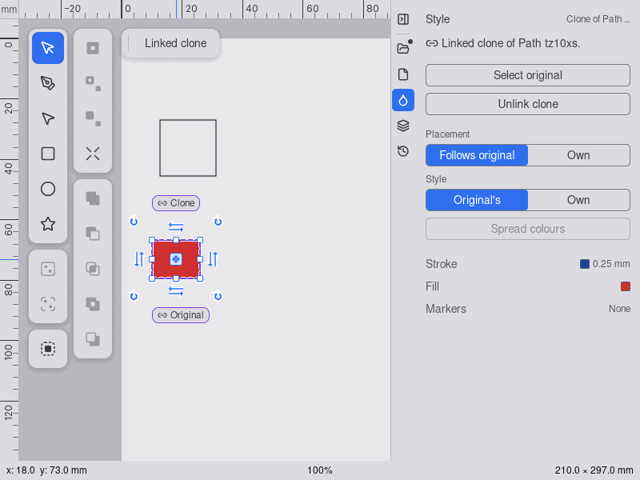
`01`: one clone, both rows at their default, Spread colours disabled, greyed headers.
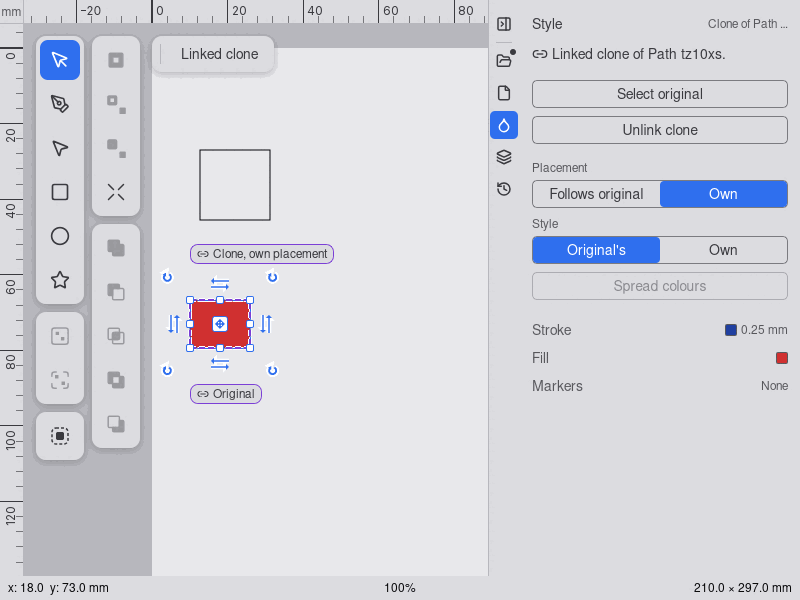
`02`: the Placement notice over the Style row; tag "Clone, own placement".
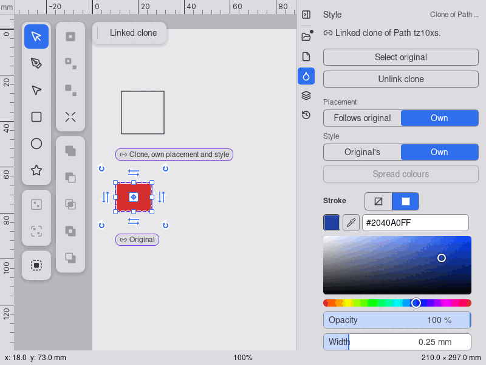
`03`: Style Own: Stroke opens in place; notice over Spread colours.
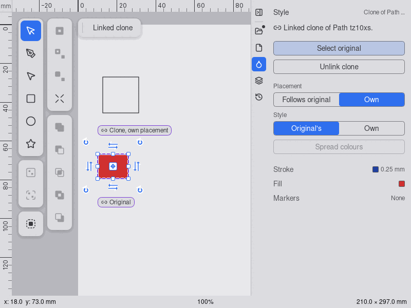
`04`: after Original's from a scrolled panel: block back at the top, pointer on Select original.
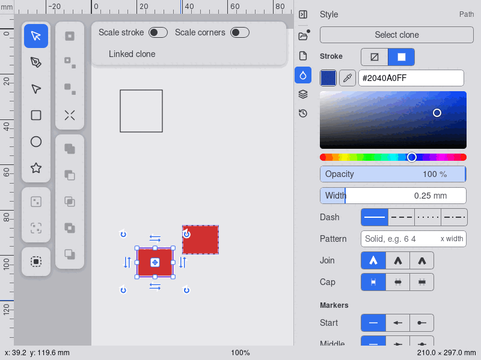
`05`: the original (a path) shows Markers rows in Stroke; a clone with own style does not.
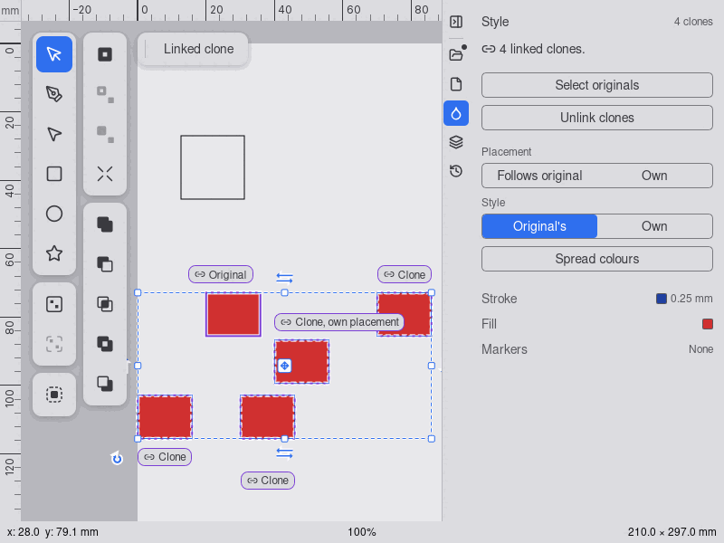
`06`: four clones, mixed placement: no segment pressed.
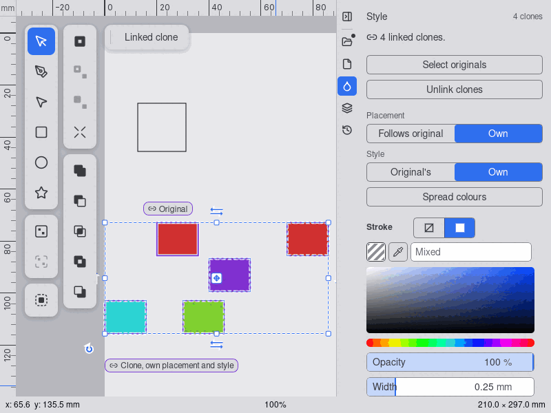
`07`: Spread colours on four clones; notice over the Stroke header.
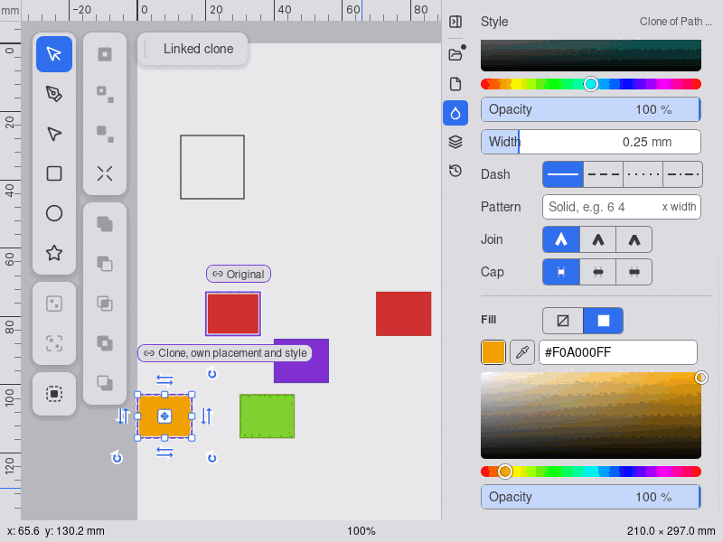
`08`: one clone's fill changed, the others keep theirs.
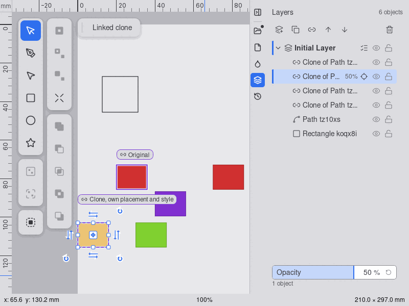
`09`: Layers Opacity at 50 % on an own-style clone.
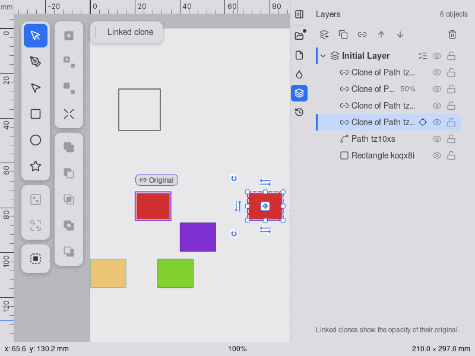
`10`: Original's clone: caption instead of the slider.
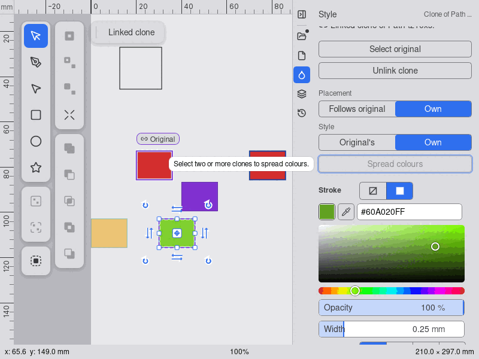
`11`: disabled Spread colours with key focus and its tooltip.

## Re-check of must-fix 1 to 4 (head 83fc550, 2026-10-15): CHANGES REQUESTED

PASS: **1** (with Own the Stroke section has Start, Middle and End markers; the greyed headers read Stroke, Markers, divider, Fill, as the sections open, `12`), **3** (the notice is right-aligned with `pointer-events: none`; a press on Style Own lands while it shows, and the next press hides it), **4** (the skip notice appears 4 px under the Stroke header after a typed stroke colour on an Own and an Original's clone, `14`, and in the Layers tab after an opacity edit).
Still must-fix:
- **2, the scroll jump, still happens.** Seen twice: scrolled to 150, then Original's pressed at y = 100. Afterwards `scrollTop` is 3 and `scrollHeight` 535: the spacer is only 3 px. The Style row moves from y = 86 to 233, and the pointer lands on Select original, which shows its tooltip and hover box (`13`). In the first layout effect of `StyleSection.tsx`, `lost` is measured against a `scrollHeight` of about 679 px instead of the collapsed one. Fix: at press time, record the panel body's height and use spacer = height before − height after the collapse (or measure in a `requestAnimationFrame` after the commit).

## Re-check of must-fix 2 (head 4c15985, 2026-10-15): APPROVE

PASS: scrolled to 150, Original's pressed at y = 100: `scrollTop` stays at 150, the Style row stays at y = 86, and the pointer stays on "Original's style" (`15`). The spacer is gone after the next selection change (`scrollHeight` 532, `scrollTop` 0). Must-fix 1 to 4 are all done; should-fix 5 to 9 stay open.
