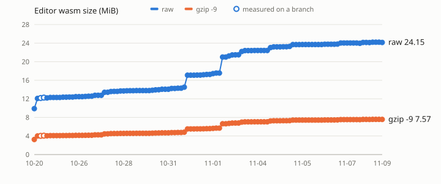

# Editor wasm size

Release `curvyo_editor_wasm_bg.wasm` after wasm-bindgen, no wasm-opt, as built by
`frontend/scripts/build-wasm.sh`. Recorded by the CI job `wasm size` on every push to
`main`; rows whose ref is not `main` were measured on a branch by hand.

| Date (UTC) | Commit | PR | Ref | Bytes | gzip -9 | Bytes change |
|---|---|---|---|---|---|---|
| 2026-11-12 | `7ab2fee` | #339 | main | 26,689,102 | 8,428,517 | -7,790 |
| 2026-11-12 | `cf02604` | #337 | main | 26,696,892 | 8,428,245 | +3,090 |
| 2026-11-12 | `38b12b6` | #336 | main | 26,693,802 | 8,426,019 | +0 |
| 2026-11-12 | `df059b9` | #334 | main | 26,693,802 | 8,426,019 | +0 |
| 2026-11-12 | `0995779` | #333 | main | 26,693,802 | 8,426,019 | +426,535 |
| 2026-11-11 | `7adfd78` | #290 | main | 26,267,267 | 8,277,536 | +358,047 |
| 2026-11-11 | `c523363` | #332 | main | 25,909,220 | 8,147,901 | +0 |
| 2026-11-11 | `54f241c` | #331 | main | 25,909,220 | 8,147,901 | +0 |
| 2026-11-11 | `02c4b1e` | #330 | main | 25,909,220 | 8,147,901 | +142,718 |
| 2026-11-11 | `127a2d4` | #326 | main | 25,766,502 | 8,098,324 | +2,546 |
| 2026-11-11 | `dd31db0` | #329 | main | 25,763,956 | 8,099,142 | +0 |
| 2026-11-11 | `3ff38b1` | #328 | main | 25,763,956 | 8,099,142 | +0 |
| 2026-11-11 | `e73884a` | #325 | main | 25,763,956 | 8,099,142 | +0 |
| 2026-11-11 | `75971b3` | #324 | main | 25,763,956 | 8,099,142 | +0 |
| 2026-11-11 | `e44a7bf` | #323 | main | 25,763,956 | 8,099,142 | +0 |
| 2026-11-11 | `6ba61fb` | #322 | main | 25,763,956 | 8,099,142 | +0 |
| 2026-11-11 | `79c9687` | #321 | main | 25,763,956 | 8,099,142 | +0 |
| 2026-11-11 | `42935b2` | #319 | main | 25,763,956 | 8,099,142 | +0 |
| 2026-11-11 | `fa2ab40` | #316 | main | 25,763,956 | 8,099,142 | -1,198 |
| 2026-11-11 | `583dc76` | #318 | main | 25,765,154 | 8,099,587 | +0 |
| 2026-11-11 | `dc89020` | #317 | main | 25,765,154 | 8,099,587 | +0 |
| 2026-11-11 | `8c1dceb` | #313 | main | 25,765,154 | 8,099,587 | +233,070 |
| 2026-11-11 | `c56eb0e` | #314 | main | 25,532,084 | 8,005,798 | +0 |
| 2026-11-11 | `aa3bdb2` | #315 | main | 25,532,084 | 8,005,798 | +0 |
| 2026-11-10 | `09c68aa` | #312 | main | 25,532,084 | 8,005,798 | +37,424 |
| 2026-11-10 | `3d935bd` | #311 | main | 25,494,660 | 7,993,144 | -3,594 |
| 2026-11-10 | `8a9990e` | #310 | main | 25,498,254 | 7,993,651 | +0 |
| 2026-11-10 | `2acafb5` | #309 | main | 25,498,254 | 7,993,651 | +0 |
| 2026-11-10 | `8087e11` | #308 | main | 25,498,254 | 7,993,651 | +0 |
| 2026-11-10 | `4e21245` | #307 | main | 25,498,254 | 7,993,651 | +0 |
| 2026-11-10 | `ab64cdb` | #305 | main | 25,498,254 | 7,993,651 | +164,943 |
| 2026-11-10 | `c37e4fc` | #306 | main | 25,333,311 | 7,939,050 | +711 |
| 2026-11-10 | `1dae910` | #303 | main | 25,332,600 | 7,939,068 | +16,036 |
| 2026-11-10 | `168b27c` | #304 | main | 25,316,564 | 7,933,611 | -1,665 |
| 2026-11-09 | `0ca5709` | #302 | main | 25,318,229 | 7,933,734 | +0 |
| 2026-11-09 | `fcc5223` | #298 | main | 25,318,229 | 7,933,734 | -49,049 |
| 2026-11-09 | `7b4d70d` | #301 | main | 25,367,278 | 7,951,314 | +0 |
| 2026-11-09 | `edc0281` | #300 | main | 25,367,278 | 7,951,314 | +0 |
| 2026-11-09 | `225228c` | #299 | main | 25,367,278 | 7,951,314 | +79,561 |
| 2026-11-09 | `dabd827` | #295 | main | 25,287,717 | 7,923,289 | -27,994 |
| 2026-11-09 | `98e10c8` | #297 | main | 25,315,711 | 7,932,885 | +0 |
| 2026-11-09 | `5903835` | #296 | main | 25,315,711 | 7,932,885 | +193,762 |
| 2026-11-09 | `c48e3e1` | #294 | main | 25,121,949 | 7,874,679 | -72,816 |
| 2026-11-09 | `6d06a75` | #293 | main | 25,194,765 | 7,890,346 | +0 |
| 2026-11-09 | `23bc6c9` | #292 | main | 25,194,765 | 7,890,346 | +0 |
| 2026-11-09 | `88560aa` | #291 | main | 25,194,765 | 7,890,346 | +0 |
| 2026-11-07 | `9ca3ebb` | #289 | main | 25,194,765 | 7,890,346 | +0 |
| 2026-11-06 | `b5a1cc4` | #288 | main | 25,194,765 | 7,890,346 | +0 |
| 2026-11-06 | `2f58d8d` | #281 | main | 25,194,765 | 7,890,346 | +251,909 |
| 2026-11-06 | `a3b6eea` | #287 | main | 24,942,856 | 7,823,375 | +34,815 |
| 2026-11-06 | `5b3fb21` | #285 | main | 24,908,041 | 7,808,767 | +0 |
| 2026-11-06 | `b0a0215` | #286 | main | 24,908,041 | 7,808,767 | +0 |
| 2026-11-06 | `bedbec0` | #284 | main | 24,908,041 | 7,808,767 | +0 |
| 2026-11-06 | `d27ad61` | #283 | main | 24,908,041 | 7,808,767 | +55,959 |
| 2026-11-06 | `a4ee1e5` | #280 | main | 24,852,082 | 7,786,941 | +0 |
| 2026-11-06 | `fb2bc9b` | #282 | main | 24,852,082 | 7,786,941 | -18 |
| 2026-11-05 | `dfd760f` | #279 | main | 24,852,100 | 7,787,348 | +10,916 |
| 2026-11-05 | `9bb96c3` | #277 | main | 24,841,184 | 7,782,347 | +2,576 |
| 2026-11-05 | `21bc909` | #278 | main | 24,838,608 | 7,780,962 | +0 |
| 2026-11-05 | `edf7e24` | #273 | main | 24,838,608 | 7,780,962 | +0 |
| 2026-11-05 | `94b5ceb` | #274 | main | 24,838,608 | 7,780,962 | +4,821 |
| 2026-11-05 | `b1b9d35` | #276 | main | 24,833,787 | 7,779,627 | +1,323 |
| 2026-11-05 | `8c68850` | #275 | main | 24,832,464 | 7,777,558 | +0 |
| 2026-11-05 | `cfe399a` | #270 | main | 24,832,464 | 7,777,558 | +420,191 |
| 2026-11-05 | `8dd8116` | #271 | main | 24,412,273 | 7,658,725 | +58,907 |
| 2026-11-04 | `ed68b00` | #266 | main | 24,353,366 | 7,640,072 | +0 |
| 2026-11-04 | `d1275c7` | #260 | main | 24,353,366 | 7,640,072 | +38,392 |
| 2026-11-04 | `72c5d27` | #268 | main | 24,314,974 | 7,624,743 | +0 |
| 2026-11-04 | `9a4001a` | #267 | main | 24,314,974 | 7,624,743 | +0 |
| 2026-11-04 | `d32a78b` | #258 | main | 24,314,974 | 7,624,743 | +158,549 |
| 2026-11-04 | `caabb49` | #264 | main | 24,156,425 | 7,585,532 | +649,479 |
| 2026-11-04 | `5009778` | #263 | main | 23,506,946 | 7,396,551 | +0 |
| 2026-11-04 | `5c9be54` | #262 | main | 23,506,946 | 7,396,551 | +0 |
| 2026-11-04 | `9decd61` | #261 | main | 23,506,946 | 7,396,551 | +0 |
| 2026-11-04 | `e3c7f19` | #257 | main | 23,506,946 | 7,396,551 | +0 |
| 2026-11-03 | `ab5ee2d` | #252 | main | 23,506,946 | 7,396,551 | +38,311 |
| 2026-11-03 | `bfff3f7` | #256 | main | 23,468,635 | 7,380,911 | +0 |
| 2026-11-03 | `903ba36` | #254 | main | 23,468,635 | 7,380,911 | +0 |
| 2026-11-03 | `70ca3c4` | #255 | main | 23,468,635 | 7,380,911 | +207,901 |
| 2026-11-03 | `850eca9` | #253 | main | 23,260,734 | 7,321,673 | +733,906 |
| 2026-11-03 | `f60a197` | #251 | main | 22,526,828 | 7,117,190 | +9,269 |
| 2026-11-03 | `49716eb` | #250 | main | 22,517,559 | 7,112,645 | +23,774 |
| 2026-11-03 | `4ea207b` | #247 | main | 22,493,785 | 7,103,450 | +224,373 |
| 2026-11-02 | `94f55ce` | #248 | main | 22,269,412 | 7,033,132 | +250,285 |
| 2026-11-02 | `105b981` | #249 | main | 22,019,127 | 6,945,656 | +0 |
| 2026-11-02 | `e77fb42` | #244 | main | 22,019,127 | 6,945,656 | +3,610,054 |
| 2026-11-02 | `595d18b` | #245 | main | 18,409,073 | 5,966,834 | +0 |
| 2026-11-02 | `8a84e70` | #246 | main | 18,409,073 | 5,966,834 | +133,927 |
| 2026-11-01 | `d4ae045` | #243 | main | 18,275,146 | 5,917,273 | +172,592 |
| 2026-11-01 | `b218736` | #241 | main | 18,102,554 | 5,853,359 | +19,896 |
| 2026-11-01 | `2f12de8` | #239 | main | 18,082,658 | 5,845,024 | +69,800 |
| 2026-11-01 | `c52d775` | #238 | main | 18,012,858 | 5,822,601 | +62,774 |
| 2026-11-01 | `0e42d62` | #240 | main | 17,950,084 | 5,799,870 | -1,294 |
| 2026-11-01 | `75d5493` | #237 | main | 17,951,378 | 5,799,770 | +34,223 |
| 2026-11-01 | `b7b45fa` | #236 | main | 17,917,155 | 5,789,917 | +0 |
| 2026-11-01 | `6497bb8` | #235 | main | 17,917,155 | 5,789,917 | +0 |
| 2026-10-31 | `974867d` | #228 | main | 17,917,155 | 5,789,917 | +2,699,938 |
| 2026-10-31 | `cfb204d` | #234 | main | 15,217,217 | 5,057,735 | +236,398 |
| 2026-10-31 | `31abead` | #233 | main | 14,980,819 | 4,982,197 | +0 |
| 2026-10-31 | `5ddddab` | #232 | main | 14,980,819 | 4,982,197 | +53,392 |
| 2026-10-31 | `d8b79e6` | #231 | main | 14,927,427 | 4,962,984 | +0 |
| 2026-10-31 | `59595a9` | #230 | main | 14,927,427 | 4,962,984 | +171,758 |
| 2026-10-31 | `54c74cc` | #229 | main | 14,755,669 | 4,906,498 | +0 |
| 2026-10-30 | `abf845f` | #227 | main | 14,755,669 | 4,906,498 | +5,492 |
| 2026-10-30 | `3b58ab4` | #225 | main | 14,750,177 | 4,904,685 | +105,073 |
| 2026-10-30 | `8043943` | #226 | main | 14,645,104 | 4,868,842 | +30,698 |
| 2026-10-30 | `4cb8df3` | #224 | main | 14,614,406 | 4,856,290 | +84,959 |
| 2026-10-30 | `6e3f913` | #223 | main | 14,529,447 | 4,827,992 | +78,668 |
| 2026-10-29 | `db776a0` | #222 | main | 14,450,779 | 4,799,148 | +0 |
| 2026-10-29 | `d6df9c7` | #221 | main | 14,450,779 | 4,799,148 | +0 |
| 2026-10-29 | `faeb6f0` | #220 | main | 14,450,779 | 4,799,148 | +0 |
| 2026-10-29 | `3d883bb` | #219 | main | 14,450,779 | 4,799,148 | +0 |
| 2026-10-29 | `a8fa241` | #218 | main | 14,450,779 | 4,799,148 | +39,233 |
| 2026-10-29 | `439ccf3` | #217 | main | 14,411,546 | 4,797,027 | +14 |
| 2026-10-29 | `5801a69` | #216 | main | 14,411,532 | 4,797,193 | +14,700 |
| 2026-10-28 | `8494275` | #215 | main | 14,396,832 | 4,794,704 | +30,185 |
| 2026-10-28 | `da69bef` | #214 | main | 14,366,647 | 4,783,587 | +0 |
| 2026-10-28 | `7068fc8` | #213 | main | 14,366,647 | 4,783,587 | +100,689 |
| 2026-10-27 | `fd6baf5` | #212 | main | 14,265,958 | 4,745,475 | +0 |
| 2026-10-27 | `ed98d6e` | #211 | main | 14,265,958 | 4,745,475 | +25,022 |
| 2026-10-27 | `704eaab` | #210 | main | 14,240,936 | 4,735,673 | +176,692 |
| 2026-10-27 | `41ee911` | #209 | main | 14,064,244 | 4,674,174 | +4,663 |
| 2026-10-27 | `e3f48e4` | #207 | main | 14,059,581 | 4,672,553 | +679,312 |
| 2026-10-27 | `b30718b` | #208 | main | 13,380,269 | 4,443,005 | +1,330 |
| 2026-10-27 | `53dd79d` | #206 | main | 13,378,939 | 4,442,173 | +0 |
| 2026-10-26 | `d5e3a0b` | #205 | main | 13,378,939 | 4,442,173 | +200,756 |
| 2026-10-26 | `8b3628b` | #204 | main | 13,178,183 | 4,366,095 | +4,805 |
| 2026-10-26 | `4219c87` | #203 | main | 13,173,378 | 4,363,343 | +51,154 |
| 2026-10-26 | `cf0865c` | #202 | main | 13,122,224 | 4,343,306 | +42,860 |
| 2026-10-26 | `99eb1c7` | #201 | main | 13,079,364 | 4,328,804 | +0 |
| 2026-10-26 | `8f2e4f3` | #200 | main | 13,079,364 | 4,328,804 | +0 |
| 2026-10-26 | `ee0f2ab` | #199 | main | 13,079,364 | 4,328,804 | +86,667 |
| 2026-10-26 | `a1ccf09` | #198 | main | 12,992,697 | 4,308,490 | +0 |
| 2026-10-26 | `6374518` | #197 | main | 12,992,697 | 4,308,490 | +29,723 |
| 2026-10-25 | `7046e12` | #196 | main | 12,962,974 | 4,295,831 | +0 |
| 2026-10-25 | `d979b24` | #193 | main | 12,962,974 | 4,295,831 | +64,344 |
| 2026-10-25 | `6be85ac` | #195 | main | 12,898,630 | 4,275,705 | +0 |
| 2026-10-25 | `cd9a835` | #194 | main | 12,898,630 | 4,275,705 | +0 |
| 2026-10-25 | `d3204ba` | #192 | main | 12,898,630 | 4,275,705 | +1,504 |
| 2026-10-25 | `63aa7d1` | #190 | main | 12,897,126 | 4,275,845 | +108,659 |
| 2026-10-24 | `29a258c` | #191 | main | 12,788,467 | 4,232,978 | +118,172 |
| 2026-10-24 | `3082c82` |  | story/text-on-path (branch) | 12,866,733 | 4,268,422 | +196,438 |
| 2026-10-24 | `5cb7a0a` |  | story/text-kerning (branch) | 12,763,446 | 4,227,451 | +93,151 |
| 2026-10-24 | `3ff03cf` |  | main | 12,670,295 | 4,202,645 | +2,296,304 |
| 2026-10-20 | `4ece1b1` |  | main | 10,373,991 | 3,405,489 |  |
