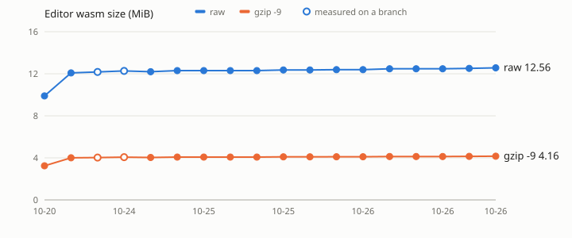

# Editor wasm size

Release `curvyo_editor_wasm_bg.wasm` after wasm-bindgen, no wasm-opt, as built by
`frontend/scripts/build-wasm.sh`. Recorded by the CI job `wasm size` on every push to
`main`; rows whose ref is not `main` were measured on a branch by hand.

| Date (UTC) | Commit | PR | Ref | Bytes | gzip -9 | Bytes change |
|---|---|---|---|---|---|---|
| 2026-11-01 | `d4ae045` | #243 | main | 18,275,146 | 5,917,273 | +172,592 |
| 2026-11-01 | `b218736` | #241 | main | 18,102,554 | 5,853,359 | +19,896 |
| 2026-11-01 | `2f12de8` | #239 | main | 18,082,658 | 5,845,024 | +69,800 |
| 2026-11-01 | `c52d775` | #238 | main | 18,012,858 | 5,822,601 | +62,774 |
| 2026-11-01 | `0e42d62` | #240 | main | 17,950,084 | 5,799,870 | -1,294 |
| 2026-11-01 | `75d5493` | #237 | main | 17,951,378 | 5,799,770 | +34,223 |
| 2026-11-01 | `b7b45fa` | #236 | main | 17,917,155 | 5,789,917 | +0 |
| 2026-11-01 | `6497bb8` | #235 | main | 17,917,155 | 5,789,917 | +0 |
| 2026-10-31 | `974867d` | #228 | main | 17,917,155 | 5,789,917 | +2,699,938 |
| 2026-10-31 | `cfb204d` | #234 | main | 15,217,217 | 5,057,735 | +236,398 |
| 2026-10-31 | `31abead` | #233 | main | 14,980,819 | 4,982,197 | +0 |
| 2026-10-31 | `5ddddab` | #232 | main | 14,980,819 | 4,982,197 | +53,392 |
| 2026-10-31 | `d8b79e6` | #231 | main | 14,927,427 | 4,962,984 | +0 |
| 2026-10-31 | `59595a9` | #230 | main | 14,927,427 | 4,962,984 | +171,758 |
| 2026-10-31 | `54c74cc` | #229 | main | 14,755,669 | 4,906,498 | +0 |
| 2026-10-30 | `abf845f` | #227 | main | 14,755,669 | 4,906,498 | +5,492 |
| 2026-10-30 | `3b58ab4` | #225 | main | 14,750,177 | 4,904,685 | +105,073 |
| 2026-10-30 | `8043943` | #226 | main | 14,645,104 | 4,868,842 | +30,698 |
| 2026-10-30 | `4cb8df3` | #224 | main | 14,614,406 | 4,856,290 | +84,959 |
| 2026-10-30 | `6e3f913` | #223 | main | 14,529,447 | 4,827,992 | +78,668 |
| 2026-10-29 | `db776a0` | #222 | main | 14,450,779 | 4,799,148 | +0 |
| 2026-10-29 | `d6df9c7` | #221 | main | 14,450,779 | 4,799,148 | +0 |
| 2026-10-29 | `faeb6f0` | #220 | main | 14,450,779 | 4,799,148 | +0 |
| 2026-10-29 | `3d883bb` | #219 | main | 14,450,779 | 4,799,148 | +0 |
| 2026-10-29 | `a8fa241` | #218 | main | 14,450,779 | 4,799,148 | +39,233 |
| 2026-10-29 | `439ccf3` | #217 | main | 14,411,546 | 4,797,027 | +14 |
| 2026-10-29 | `5801a69` | #216 | main | 14,411,532 | 4,797,193 | +14,700 |
| 2026-10-28 | `8494275` | #215 | main | 14,396,832 | 4,794,704 | +30,185 |
| 2026-10-28 | `da69bef` | #214 | main | 14,366,647 | 4,783,587 | +0 |
| 2026-10-28 | `7068fc8` | #213 | main | 14,366,647 | 4,783,587 | +100,689 |
| 2026-10-27 | `fd6baf5` | #212 | main | 14,265,958 | 4,745,475 | +0 |
| 2026-10-27 | `ed98d6e` | #211 | main | 14,265,958 | 4,745,475 | +25,022 |
| 2026-10-27 | `704eaab` | #210 | main | 14,240,936 | 4,735,673 | +176,692 |
| 2026-10-27 | `41ee911` | #209 | main | 14,064,244 | 4,674,174 | +4,663 |
| 2026-10-27 | `e3f48e4` | #207 | main | 14,059,581 | 4,672,553 | +679,312 |
| 2026-10-27 | `b30718b` | #208 | main | 13,380,269 | 4,443,005 | +1,330 |
| 2026-10-27 | `53dd79d` | #206 | main | 13,378,939 | 4,442,173 | +0 |
| 2026-10-26 | `d5e3a0b` | #205 | main | 13,378,939 | 4,442,173 | +200,756 |
| 2026-10-26 | `8b3628b` | #204 | main | 13,178,183 | 4,366,095 | +4,805 |
| 2026-10-26 | `4219c87` | #203 | main | 13,173,378 | 4,363,343 | +51,154 |
| 2026-10-26 | `cf0865c` | #202 | main | 13,122,224 | 4,343,306 | +42,860 |
| 2026-10-26 | `99eb1c7` | #201 | main | 13,079,364 | 4,328,804 | +0 |
| 2026-10-26 | `8f2e4f3` | #200 | main | 13,079,364 | 4,328,804 | +0 |
| 2026-10-26 | `ee0f2ab` | #199 | main | 13,079,364 | 4,328,804 | +86,667 |
| 2026-10-26 | `a1ccf09` | #198 | main | 12,992,697 | 4,308,490 | +0 |
| 2026-10-26 | `6374518` | #197 | main | 12,992,697 | 4,308,490 | +29,723 |
| 2026-10-25 | `7046e12` | #196 | main | 12,962,974 | 4,295,831 | +0 |
| 2026-10-25 | `d979b24` | #193 | main | 12,962,974 | 4,295,831 | +64,344 |
| 2026-10-25 | `6be85ac` | #195 | main | 12,898,630 | 4,275,705 | +0 |
| 2026-10-25 | `cd9a835` | #194 | main | 12,898,630 | 4,275,705 | +0 |
| 2026-10-25 | `d3204ba` | #192 | main | 12,898,630 | 4,275,705 | +1,504 |
| 2026-10-25 | `63aa7d1` | #190 | main | 12,897,126 | 4,275,845 | +108,659 |
| 2026-10-24 | `29a258c` | #191 | main | 12,788,467 | 4,232,978 | +118,172 |
| 2026-10-24 | `3082c82` |  | story/text-on-path (branch) | 12,866,733 | 4,268,422 | +196,438 |
| 2026-10-24 | `5cb7a0a` |  | story/text-kerning (branch) | 12,763,446 | 4,227,451 | +93,151 |
| 2026-10-24 | `3ff03cf` |  | main | 12,670,295 | 4,202,645 | +2,296,304 |
| 2026-10-20 | `4ece1b1` |  | main | 10,373,991 | 3,405,489 |  |
